# AEGIS-FX V4 — Revised Plan

*Built on the AEGIS-FX V3 Master Build Specification. Date: 2026-10-06.*

This plan **amends V3**. Where they conflict, this plan wins. Anything V3 says that this plan doesn't touch stays as written, **except the sections listed in §2.1, which are superseded or deferred**. In this document, "§N" means a section of this plan and "V3 §N" means a section of V3.

The evidence behind every change is in [`REVIEW.md`](REVIEW.md). That was a five-lens review (statistics, data, risk/execution, architecture/LLM, red team). Each lens went to an adversarial verifier, who re-ran the numbers and fact-checked about 100 claims. A second verification pass then checked this plan itself for completeness, arithmetic and buildability.

Nothing here claims the system is profitable, accurate, low-risk or production-ready (V3 §68). The plan is designed to find out, cheaply and honestly, whether an edge exists. It only builds the live system if one does.

### How to read this plan

- **Your next action:** answer §15 (rough answers are fine), then Stage 0 (§16).
- **Built now (Stages 0–3, research only):**
  - §5, the strategy and pre-registration;
  - §6.1, "needed now" rows only;
  - §6.3–§6.5;
  - §7.1;
  - §7.2, the gate list;
  - §7.3, backtest fills and delay stress;
  - §7.4, the cost and sizing model;
  - §10;
  - §11, Stages 0–3, with the definition of done in §11.1;
  - §12, the unit, property, leakage and golden-decision tests.

  In Stages 0–3, create only `core/`, `strategies/`, `data/`, `sim/`, `drivers/backtest.py`, `drivers/replay.py`, `research/`, `reports/` and `tests/`.
- **Design reference only, not built before G3 = GO:** §4.4, §7.5–§7.7, §8, §9, the live parts of §12, and Stages 4+ in §11. These are written now so the `core/` interfaces anticipate them.
- **Most likely outcome:** NO-GO or NOT_EVALUABLE at Stage 3 (see §5, last paragraph). That counts as a successful run of this plan, not a failed build.
- **Terms:** R, N_eff, MDE, DSR, PBO and the rest are defined in the glossary (Appendix A).

---

## 1. Verdict on V3 and the 30 additions

**V3 is a strong safety specification wrapped around a strategy that doesn't exist yet.** Its doctrine is right and is kept: Python calculates, the LLM never authorises, fail closed, completed candles only, structured gate results, versioning, and no auto-execution. As a plan to *find and deliver an edge*, it has four critical flaws:

| # | Problem | Why it matters |
|---|---|---|
| 1 | **No strategy is defined.** There is no entry trigger, stop formula, target rule, time exit or session. | The backtest, walk-forward and sample-size rules (V3 §40–§49) have nothing fixed to test. Whoever writes the code invents the strategy, and every choice made along the way is an unrecorded degree of freedom. |
| 2 | **The live decision rule can't be validated.** The confluence components you can compute from price and spread sum to 70. Reaching 90 needs ≥ 20 of the 30 fundamental + sentiment points, and V3 names no point-in-time (PIT) source for them. The LLM agents sit *before* confluence. | An LLM reading a historical date already knows what happened next. Claude Opus 5.5's training cutoff is June 2026, so only about 3 months of clean data exist. The system you could backtest is not the system that would send alerts. |
| 3 | **Sample sizes are unreachable.** EURUSD-only with 19 conditions ANDed together gives roughly 5–25 qualifying signals a year (an estimate). | 500 historical signals would take 20–100 years. Showing a +0.15R edge with 80% power needs about 590 *effective* trades. |
| 4 | **Build order.** Backtesting comes at phase 14 of 18. | About 22–33 part-time weeks pass before the first pre-registered out-of-sample result, versus about 7–10 weeks for a minimal research-first scope. These are assumption-driven estimates, but the direction is clear. The backtest also ends up bolted onto the live engine. |

Two further HIGH-severity gaps:

- **The step between alert and trade is undefined.** V3 has no order type, entry tolerance, expiry, trade management, or link between the human's MT5 trades and signals. Live results would not be comparable with the backtest.
- **The objectives don't fit together, and the payoff is small.**
  - A 60–68% win rate at net R:R ≥ 2 means at least +0.8R per trade, an annual Sharpe of about 2.7–4.6. Break-even at 2R is a 33.3% win rate.
  - The "false-positive <20–30%" target contradicts the win-rate target.
  - Even a *real* edge of +0.10–0.25R earns little at 0.25% risk: about **0.25–1.6% a year** at V3's likely 10–25 trades, and about **0.9–6.5% a year** at this plan's H1 design frequency on EURUSD alone (0.7–2 signals a week). Both are upper bounds, before unfilled orders, missed alerts and execution shortfall.

**The 30 additions** (full table in §13):

- **12 are kept**, including #18 ablation, #27 cost stress, #29 minimum complexity, #21/#22 reason codes and replay, #12 shrinkage and #2 evidence ≠ probability.
- **11 are useful once modified.**
- **7 are deferred or dropped.**

The threshold-heavy ones (#1, #3, #4, #5, #8, #10, #13, #16) add roughly 100 tunable thresholds, which makes overfitting *more* likely and contradicts #29. One finding matters most: a single researcher iterating over 100–1,000 variants on pure noise can produce +0.17 to +0.32R in-sample expectancy. That is exactly the size of a plausible real edge.

**My answer to "do you have a better idea":** yes. Treat AEGIS as a **research programme with a delivery system attached**, not as a delivery system that will be validated afterwards:

1. Freeze one simple, falsifiable strategy before looking at any data.
2. Test it with a leakage-free backtester across a pool of pairs.
3. Decide GO / NO-GO with numbers fixed in advance.
4. Only then build the MT5 → Telegram → human loop, sharing the *same* decision code.

The LLM becomes a narrator and red-teamer that runs after the deterministic decision. A GO is permission to collect designer-blind forward evidence, not proof of an edge.

**Figure 1. What changes in the order of operations.** V3 §1 puts LLM analysis *before* confluence and human review *before* Telegram. V4 keeps the LLM out of the decision of record and closes the loop back to research.

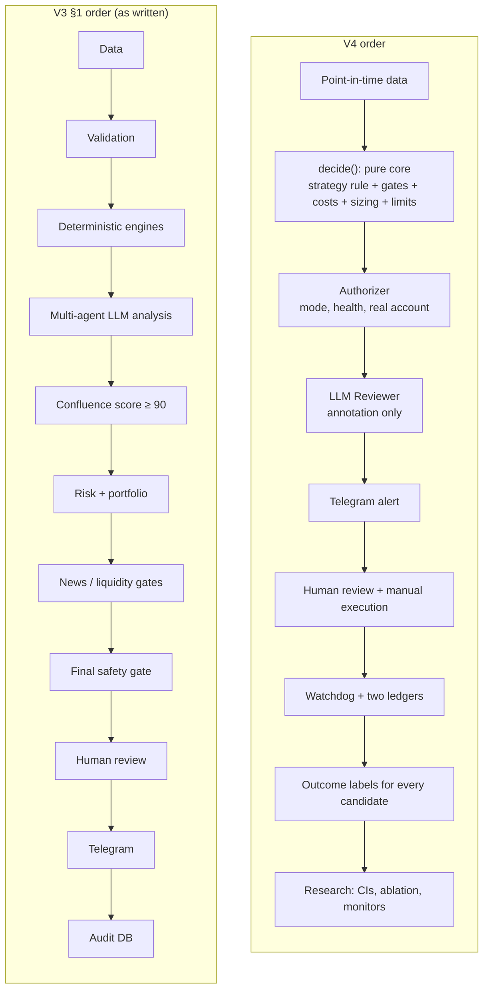

---

## 2. Kept from V3

- **Doctrine:**
  - V3 §1's rule: the LLM interprets, Python calculates and enforces, fail closed. Its pipeline *order* is replaced by Figure 1.
  - V3 §2.1 and §2.2, and V3 §69.
- **Data handling:**
  - V3 §5: per-record source, timestamps and quality status, with Pydantic at every boundary.
  - V3 §6: forming vs completed candle, and the validation checks.
  - V3 §41: the leakage list.
  - V3 §56: process each completed candle exactly once, keyed by timestamp.
- **Gates and risk rules:**
  - V3 §35's principle: structured results, never a bare Boolean. It is split into `decide()` and the authorizer (§4.3).
  - V3 §54: fail-closed defaults.
  - V3 §22's principles: deterministic sizing, round down, recompute risk after rounding. The formula itself is replaced by §7.4.
  - V3 §23: base risk 0.25%; no risk increase for higher confluence.
  - V3 §26: all R:R rules on **net** values.
  - V3 §31: the kill switch needs a manual reset, and the LLM can't reset it.
  - V3 §33–§34: signal validity and duplicate prevention as first-class data.
  - V3 §30: daily, weekly and monthly P&L reporting.
- **Research:**
  - V3 §42: the metric list, computed in `research/metrics.py` with N, N_eff and CIs.
  - V3 §47: the Monte Carlo scope, plus a gap-loss tail.
  - V3 §50–§51: their purposes, as operational checks (§10.3).
- **Governance:**
  - V3 §39 and §59: versioning, and change → backtest → validation → approval → version bump.
  - V3 §45: N, CI, period and regime on every claim. V3 §44's fixed counts are replaced by §10.2.
  - V3 §55: security, made concrete in Stage 4 (§11).
  - V3 §58: configurability; the resolved config is hashed into every record.
  - V3 §60: the integration tests (MT5, DB, Claude, Telegram), in Stage 4+.
  - V3 §62: modes, with a permission table (§14).
  - V3 §67–§68: phase reporting and no false certification.

### 2.1 V3 sections superseded or deferred

| V3 | Status in V4 |
|---|---|
| §1 order | Replaced by Figure 1 / §4.1 |
| §3 stack | Amended (§14): Python 3.12–3.13; CrewAI optional; pandas-ta not usable |
| §4 structure | Replaced by §4.2 |
| §6 timeframes | H1 needs only H4 + M15 (and M1 for fills); H1 and M5 data pulls are deferred |
| §8–§9 | Only the indicators H1 uses (EMA, RSI, ATR, swing high/low). The rest wait for a pre-registered strategy that needs them. H1's multi-condition trend rule (§5) satisfies §9's "not just EMA50 > EMA200". M5 entry refinement is dropped: a minutes-scale edge can't be captured by a human on a phone. |
| §10, §11, §18 | Not gates in v1. Diagnostics from Stage 4; gates only via §10.5 (Stage 8) |
| §12 | Diagnostic label only. H1's trend condition is its declared regime filter. UNKNOWN (insufficient history) → `NO_TRADE_MISSING_DATA`. A regime allow/deny gate enters only via §10.5. |
| §13 | Tier-1 blackout, news-in-hold and post-news volatility checks (§7.2) |
| §14 | Kept (1.5× rule) with the baseline defined precisely (§6.4) |
| §15–§17 | Confluence score and tiers become diagnostics/labels (§7.2), Stage 4+ |
| §19–§21 | Replaced by §8 |
| §22 formula | Replaced by §7.4 |
| §25 | Each hypothesis declares its target rule. H1 uses a fixed net 2.0R; the "preferred 2.2–3.0" is dropped for v1; distance to opposing structure is a logged diagnostic. |
| §27–§29 | §7.7 (EURUSD phase); rolling correlation deferred |
| §30–§32 | §7.6 |
| §35 conjuncts | v1 conjuncts are the checks in §7.2. TECHNICAL_VALID = H1's rule conditions. FUNDAMENTAL_VALID, SENTIMENT_VALID, REGIME_VALID and CONFLUENCE ≥ 90 are removed (diagnostics). VOLATILITY_ACCEPTABLE = the anomaly checks. Daily, weekly and kill-switch conjuncts are added. |
| §36 | Replaced by §4.3 |
| §37 | Replaced by §9 |
| §38 | Extended (§14) |
| §40–§49 | Replaced by §10 |
| §43, §64 | Targets replaced by §10.1 |
| §53 | Stage 4, with blocking vs warn-only lists (§11) |
| §57 | Replaced by §4.4 |
| §61 matrix | Replaced by the v1 boundary matrix (§12) |
| §63 | Mapped in §11.2 |
| §65 | Mapped in §11.3 |
| §66 | Replaced by §11 |

---

## 3. The ten design decisions

1. **The strategy is the product.** A pre-registered, frozen rule (§5) is what everything else exists to test and then deliver.
2. **Research before infrastructure.** Nothing past the research backtester is built until a hypothesis passes a numeric gate (§11).
3. **One decision core, two drivers.** A pure function `decide(snapshot, config, ledger) → DecisionRecord` (contract in §4.5) is called by both the backtest driver and the live driver, plus a replay tool. No live/backtest re-implementation.
4. **A point-in-time contract.** Only inputs with a leakage-free history may gate, score or size. Every record carries `available_at`, the time it became knowable, and every read is `as_of(t)`.
5. **A non-compensatory rule instead of a 100-point gate.** The v1 gate is the strategy's binary conditions plus the hard risk/data gates. The confluence score becomes a diagnostic (Stage 4+) until it is calibrated against outcomes. The alert shows the rule's measured OOS expectancy with a CI, never a score dressed as quality.
6. **The LLM is outside the decision of record.** One structured Claude call runs *after* deterministic approval. It narrates, lists disconfirming evidence and flags qualitative risks. It never runs in backtests and never changes a decision.
7. **Model and measure the human.** Every signal carries an execution contract (order type, tolerance, expiry, management plan). Two ledgers separate strategy outcomes from account reality. A read-only watchdog checks what was actually placed.
8. **A statistical protocol, not targets.** A two-part pre-registration, an auto-logged trial ledger, a minimum detectable effect with a power calculation, a one-shot holdout, CIs on everything, and a matched random-entry null.
9. **Capital protection is separate from edge monitoring.** Drawdown limits and the kill switch protect money. A separate sequential test (CUSUM) watches the edge, and its detection times are published.
10. **A complexity budget.** v1 allows at most 8 signal-selecting tunables, at most 3 per hypothesis. Nothing new enters the decision path without winning a pre-registered ablation.

---

## 4. Architecture

### 4.1 Flow

**Figure 2. System architecture.** One pure decision core is shared by the backtest, replay and live drivers. The decision record is persisted as soon as it exists. Only the authorizer can create an alert. The LLM sits after it and can't change the decision.

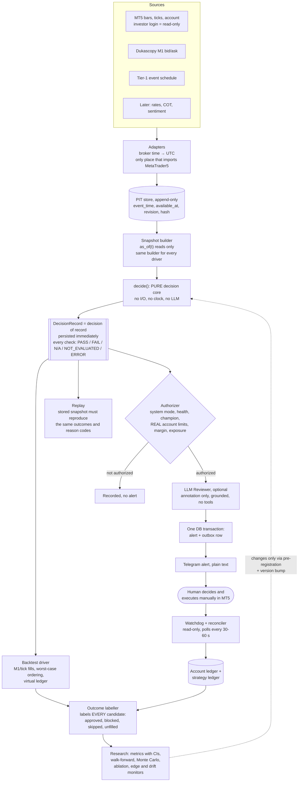

**Figure 2b. One live cycle (Stage 4+).** Every cycle ends in exactly one terminal state, and a retry never re-sends blindly.

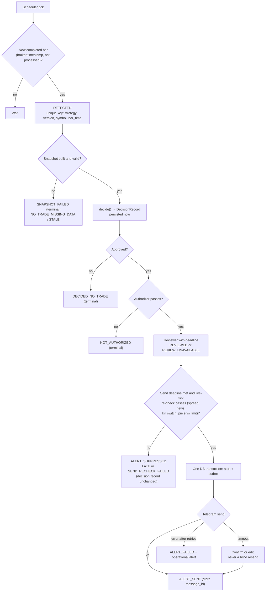

### 4.2 Module layout (V3 §4 kept where it works, with additions)

```text
aegis_fx/                     # project root (a dedicated repository is recommended, §15)
  pyproject.toml  requirements.lock  README.md  .env.example (Stage 4)
  core/            # Stage 2 · pure. CI forbids imports of MetaTrader5/anthropic/telegram/sqlalchemy/httpx
    types.py  reasons.py  canonical.py  indicators.py  structure.py
    gates/{data_quality,news,spread,session,anomaly}.py
    costs.py  sizing.py  limits.py  signal_lifecycle.py  decide.py
    score.py         # Stage 4+: diagnostic confluence score
    portfolio.py     # Stage 4+
  strategies/      # Stage 2: base.py (Strategy protocol), registry.py, trend_pullback_v1.py
  data/            # Stage 1: adapters + PIT store
    mt5_export.py  dukascopy.py  tier1_events.py  pit_store.py  snapshot_builder.py  data_quality.py
    # Stage 4+: mt5_adapter.py (live), calendar_source.py, rates_source.py, cot_source.py
  sim/             # Stage 2: fills.py, ledger.py, labeller.py, synthetic.py
  drivers/         # Stage 2: backtest.py, replay.py · Stage 4: live.py
  research/        # Stages 0–3: PREREG.md, PREREG_LOG.md, decisions.md, account_facts.yaml,
                   #   trial_ledger.py, metrics.py, walk_forward.py, monte_carlo.py, ablation.py
  reports/         # G1/G2/G3 reports, VALIDATION_TEMPLATE.md
  scripts/         # probe_history.py, count_signals.py, run_g3.py
  # Stage 4+ only:
  risk/            # authorizer.py, account_ledger.py, watchdog.py, reconciler.py
  agents/          # reviewer.py (interface), anthropic_reviewer.py, [crewai_reviewer.py optional]
  schemas/  storage/  notifications/  monitoring/  app/  config/  docs/
  tests/{unit,property,leakage,golden,backtest,integration,failure_injection,replay}
```

### 4.3 Two check families and one canonical reason scheme

**Figure 3. Inside `decide()`.** Every check is evaluated (no short-circuit). Approval needs every applicable check to pass. When there is no setup, trade-construction and sizing checks are NOT_APPLICABLE. The confluence score is a diagnostic, not a gate.

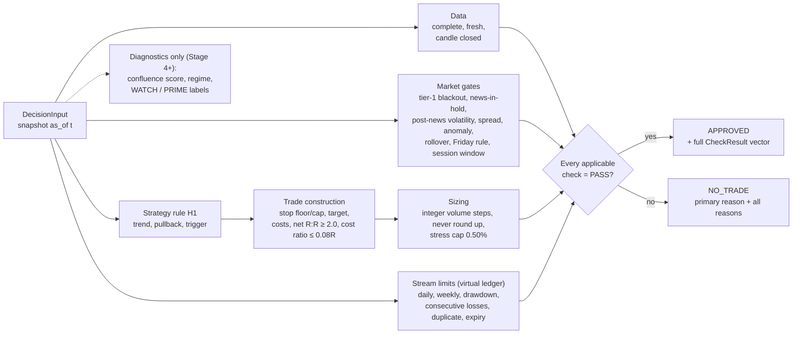

- **DecisionCheck** is evaluated inside `decide()`. It covers data, setup, market gates, costs, sizing, and the stream's own virtual-ledger limits. Every check produces `CheckResult(check, outcome, observed, threshold, unit, detail)`.
- **AuthorizationCheck** is evaluated only in `risk/authorizer.py` (Stage 4+). It covers SYSTEM_MODE, SYSTEM_HEALTH, STRATEGY_AUTHORITATIVE, real-account daily/weekly/max-DD limits, MARGIN_SAFE, real exposure, and unprotected positions. Challenger and observer streams therefore still produce full decision records.
- **Outcomes:**
  - PASS.
  - FAIL.
  - NOT_APPLICABLE: the component isn't part of this strategy, or there is no setup. It is excluded from the approval condition.
  - NOT_EVALUATED: a required check that couldn't run. Fails closed.
  - ERROR: fails closed.

  `approved ⇔ every applicable check is PASS`.
- **primary_reason** is the first non-PASS check in a fixed precedence:
  - for decisions: DATA_* > CANDLE_CLOSED > STRATEGY_RULE > MARKET gates > TRADE_CONSTRUCTION > SIZING > STREAM_LIMITS;
  - for authorization: SYSTEM_MODE > SYSTEM_HEALTH > account limits > MARGIN/EXPOSURE.

  A test asserts that every member can be reached as primary_reason.
- **Reason strings** are derived (`NO_TRADE_<CHECK>`, `PASS_<CHECK>`, `FAIL_<CHECK>`, as Addition #21 asks) from **one enum module**. A test asserts that every emitted code is a member, upper-case and unique. Input names go in `CheckResult.detail`, never in the code; for example `NO_TRADE_MISSING_DATA` with detail `calendar`.
- **V3 aliases** are an input-only mapping for reading V3-era records. They are never emitted:
  - `NO_TRADE_DRAWdown` → `NO_TRADE_MAX_DRAWDOWN`;
  - `NO_TRADE_LLM_OUTPUT_INVALID` and `NO_TRADE_INVALID_LLM_OUTPUT` → alert status `ALERT_SUPPRESSED_LLM_INVALID`;
  - `SIGNAL_EXPIRED` and `NO_TRADE_EXPIRED` → `NO_TRADE_SIGNAL_VALID`.
- **New decision codes V3 is missing:**
  - `NO_TRADE_POSITION_SIZE` (below minimum lot; never round up);
  - `NO_TRADE_STRESS_RISK`;
  - `NO_TRADE_COST_RATIO`;
  - `NO_TRADE_UNEXECUTABLE` (limit inside SYMBOL_TRADE_STOPS_LEVEL, or already marketable);
  - `NO_TRADE_NEWS_IN_HOLD`;
  - `NO_TRADE_POST_NEWS_VOLATILITY`;
  - `NO_TRADE_ROLLOVER`;
  - `NO_TRADE_FRIDAY_RULE`;
  - `NO_TRADE_SESSION_WINDOW`;
  - `NO_TRADE_MARKET_CLOSED` (not an error; it also suppresses STALE alerts);
  - `NO_TRADE_DAILY_LOSS` and `NO_TRADE_WEEKLY_LOSS` (V3 §35 has no daily or weekly conjunct as written);
  - `NO_TRADE_CONSECUTIVE_LOSSES` (virtual ledger).
- **New authorization codes:** `NO_TRADE_KILL_SWITCH`, `NO_TRADE_DEFENSIVE_MODE`, `NO_TRADE_UNPROTECTED_POSITION`.
- **Alert-stream statuses** don't change the decision: `ALERT_SUPPRESSED_LATE`, `ALERT_SUPPRESSED_SEND_RECHECK_FAILED`, `ALERT_SUPPRESSED_LLM_INVALID` (only if that config option is on).
- **Canonical integer units.** Every value a gate compares is converted first: prices and distances to integer points, lots to integer volume steps, money to cents, scores to integers. This makes cross-platform replay exact, except for values that land within float error of a rounding boundary. The parity test (§12) detects those, and every mismatch must be explained.

  Canonicalisation does **not** by itself fix the NaN fail-open bug, and can make it worse. `NaN > limit` is False in Python, so `if x > limit: fail` passes a NaN. And numpy's `astype(np.int64)` silently maps NaN and ±inf to −9,223,372,036,854,775,808, which passes any `x > limit` check. So:
  - `core/canonical.py` checks `math.isfinite(x)` / `np.isfinite(a).all()` **first** and returns ERROR for any non-finite value;
  - `ValueError` from `int()`/`round()` also maps to ERROR;
  - every gate is written to pass only on a True comparison (`passed = x <= limit`), never `failed = x > limit`.

### 4.4 Modes and state machines (replace V3 §57; Stage 4+)

- **SystemMode** is persisted and restored *exactly* on boot, so a crash or restart can never clear a kill switch, a defensive pause or an operator pause.
  - **Persisted modes:** `READY`, `DEFENSIVE`, `PAUSED`, `HALTED` (the kill switch).
  - `DEFENSIVE` is set by real taken trades (§7.6). It is left only through the recovery rule in §7.6.
  - `PAUSED` is manual in and manual out.
  - Leaving `HALTED` requires a **local CLI command** after at least 10 trading days and a written review. It records operator, reason and time. Never via Telegram or the LLM.
  - **Health and market hours are checks, not modes.** `SYSTEM_HEALTH` is an AuthorizationCheck; `NO_TRADE_MARKET_CLOSED` covers weekend, rollover and holiday sessions. Both are evaluated in every mode, so a weekend or an outage can never clear DEFENSIVE, PAUSED or HALTED.
  - ERROR is not a mode. The process exits and the supervisor restarts it into BOOTING.
- **Operating modes** (V3 §62) are a separate config setting; see the permission table in §14.
- **CycleState** is one per (strategy, version, symbol, bar_time), terminal and idempotent (Figure 2b): `DETECTED → SNAPSHOT_OK | SNAPSHOT_FAILED → DECIDED_NO_TRADE | DECIDED_APPROVED → NOT_AUTHORIZED | AUTHORIZED → REVIEWED | REVIEW_UNAVAILABLE → ALERT_QUEUED → ALERT_SENT | ALERT_FAILED | ALERT_SUPPRESSED(reason)`.
- **Entity lifecycles:**
  - Signal: Figure 5.
  - Strategy: `CANDIDATE | ACTIVE | SUSPENDED | RETIRED` × role `CHAMPION | CHALLENGER | OBSERVER`. Automatic transitions are demotions only. Promotion is a manual, recorded, version-bumping act.
- Every machine is an explicit transition table, tested over all (state, event) pairs. A test restarts the process in every persisted mode and asserts that the same mode comes back.

**Figure 4. SystemMode (persisted).** Daily and weekly loss breaches are checks that block alerts until the next boundary; they are not modes.

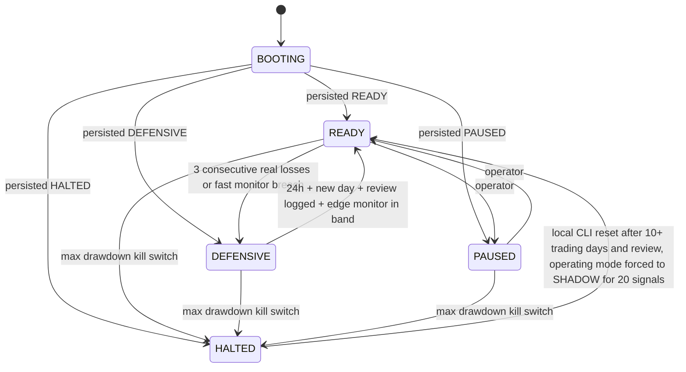

**Figure 5. Signal lifecycle.** Every signal ends with an outcome, including skipped, expired and unfilled ones (scored as counterfactual outcomes), so the statistics are not selection-biased.

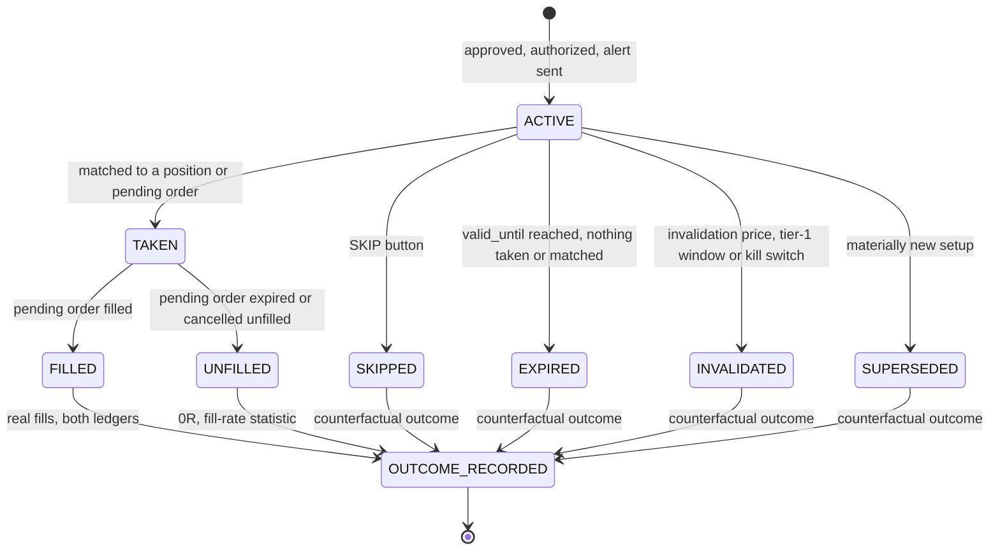

### 4.5 Core contract (Stage 2)

- **`Snapshot`** is frozen and in integer units. It holds:
  - `as_of` (UTC) and `symbol`;
  - the completed bars per timeframe with `bar_time ≤ as_of`;
  - the quote (bid, ask, time);
  - tier-1 events with `available_at ≤ as_of`;
  - the instrument spec (digits, point, tick size, `tick_value_loss`, volume min/step/max, stops level);
  - the cost model (spread by hour of week, commission, slippage);
  - data-quality flags.
- **`LedgerState`** is this stream's virtual ledger: open and pending positions, realised R today and this week, peak equity and drawdown in R, consecutive losses, and the last signal per symbol.
- **`Strategy` protocol:** `id`, `version`, `params`, and `setup(snap) -> (list[CheckResult], TradePlan | None)`.
- **`TradePlan`:** side, order_type, entry/sl/tp in points, valid_until, invalidation level.
- **`decide(snap, cfg, ledger) -> DecisionRecord`.** The strategy is resolved from `cfg.strategy_id` through `strategies/registry.py`.
- **`DecisionRecord`:** `decision_id = hash(strategy_id, version, symbol, bar_time)`, `approved`, `primary_reason`, `checks[]`, `plan`, `sizing` (target_risk, actual_risk, undershoot%), `config_hash`, `snapshot_hash`, `code_sha`.
- **When it runs:** `decide()` runs once per completed M15 bar per (strategy, symbol). If the strategy-rule checks fail, the trade-construction and sizing checks are NOT_APPLICABLE with detail "no setup".
- **Candidates:** a **candidate** is a bar where every strategy-rule check passes. Every candidate gets an outcome label (§10.5), whether or not it was approved.

---

## 5. Strategy and hypotheses (pre-registration)

Pre-registration is committed in **two parts**. Each part's git hash is recorded in `research/PREREG_LOG.md` before the next step runs.

- **Part A (Stage 0, before any code loads price data):**
  - the exact rules below;
  - at most 3 free parameters per hypothesis, each on a 3-value grid;
  - the label definition and cost model;
  - the data splits as exact dates (§10.3);
  - the baselines and the acceptance criteria (§10);
  - the MDE, the SD assumption and the resulting required N_eff (§10.2);
  - the variant budget;
  - the selection rule.
- **Part B (end of Stage 2, before any code computes a trade outcome):**
  - SHA-256 hashes of every data file and the holdout partition, plus the code commit and config hash;
  - returns-blind signal counts for every grid configuration on the development *and* holdout periods, produced by `scripts/count_signals.py`. It may not read any price after a signal bar's close plus the order expiry, so it can count fills but not outcomes;
  - the frequency-band filter applied to the grid;
  - the returns-blind pilot N_eff for the holdout, and the resulting EVALUABLE / NOT_EVALUABLE call (§10.2).

Any change after Part A is a new named variant, logged in the trial ledger.

**Definitions:**

- A *configuration* is one grid point.
- A *variant* is a named change to a rule or grid, for example "H1b: no swing-low condition". Each variant may carry its own grid of ≤ 27 points.
- The budget is **≤ 20 variants** across all hypotheses.
- **K** (for the DSR) is the number of distinct configurations ever backtested on development data, read from the trial ledger (≤ 540). B0 seeds and baseline runs don't count.
- **Selection rule (pre-registered):** in each walk-forward training fold, pick the in-band configuration with the highest lower 95% bound of E. For the holdout, the same rule applied to the whole development period picks the one configuration that is opened.

### H1 (primary, the only confirmatory test in cycle 1): H4 trend / M15 pullback continuation

This is a draft. Edit it in Stage 0, then freeze it.

- **Universe:** research pooled over EURUSD, GBPUSD, USDJPY, AUDUSD, USDCAD and USDCHF, with all distances in ATR units. A pip is 0.0001, or 0.01 on JPY pairs. Live alerts stay EURUSD-first.
- **Research window:** M15 bars closing 08:00–11:30 America/New_York (DST-aware), for every pair. Your hours (§15) only decide which *live* alerts are paper-only. A different research window is a new variant.
- **Trend (H4, completed bars):** all of the following, mirrored for shorts:
  - close > EMA200(H4);
  - EMA50(H4) > EMA50(H4) six bars earlier;
  - the last two confirmed H4 swing lows are rising (a swing low is a 5-bar fractal: the low is below the lows of the 2 bars on each side; confirmed 2 bars later).

  The trend condition must be true on the last completed H4 bar at the trigger bar's close. On synthetic data the EMA conditions alone hold about 80% of the time; the swing condition makes the filter meaningful and satisfies V3 §9. Dropping it is variant H1b.
- **Pullback:** RSI14(M15) ≤ L on at least one of the last W M15 bars.
- **Trigger:** M15 close > the prior M15 high, and RSI14(M15) > 50.
- **Entry:** BUY LIMIT at the trigger bar's **Bid close**; it fills when Ask ≤ limit. If the limit is within SYMBOL_TRADE_STOPS_LEVEL of the market, or already marketable, the result is `NO_TRADE_UNEXECUTABLE`.
- **Order expiry:** N = 4 M15 bars after the signal bar's close, or T_exit − 30 min if that is earlier. This is fixed, not tuned. An unfilled order is UNFILLED: a candidate with outcome 0R, not a trade.
- **Invalidation:** cancel before fill if an M15 bar closes beyond the pullback extreme (for longs, the lowest low of the last W bars).
- **Stop:** the pullback extreme − 0.1×ATR14(M15). The setup is rejected if `stop < max(all_in_cost / 0.08, 0.75×ATR14(M15))` or `stop > 2.0×ATR14(M15)`. This keeps costs ≤ 0.08R. At 1.0 pip all-in cost, a 6-pip stop costs 0.17R, a 10-pip stop 0.10R and a 15-pip stop 0.07R.
- **Target:** a fixed **net 2.0R**. TP is rounded *away* from entry to the next whole point, so net R:R ≥ 2.0 survives canonicalisation.
  - Consequence: d_max = 0 for H1. The limit price is the only acceptable entry, and `/check` returns GO only when Ask ≤ entry.
  - A target above net 2.0R (e.g. 2.2R, giving d_max ≈ 0.067·S_net) would be a separately pre-registered variant.
  - A structural take-profit is a separate variant too.
- **Time stop:** flat at T_exit on the entry day. At most 1 trade per pair per day. Management is set-and-forget (§7.3). H1 never holds past 16:00 New York, so it never crosses rollover or the weekend. It pays no swap and trades on Fridays, subject to the tier-1 blackout (e.g. NFP).
- **Grid (27 configurations):** L ∈ {35, 40, 45}, W ∈ {6, 8, 12}, T_exit ∈ {12:00, 14:00, 16:00 NY}. Configurations outside a frequency band of **0.7–2 signals per week per pair** (counted returns-blind in Part B) are dropped. Report the exit mix (TP / SL / time stop / unfilled).
- **Delay stress:** the same limit goes live at signal close + d (d ∈ {2, 5, 10} min) and fills only on trade-through after that. A market entry at the Ask at close + d, with the original SL/TP, is reported separately.
- **Falsified if** the holdout fails §10.4.

### Exploratory in cycle 1 (development data only; confirming any of them needs its own Part A and holdout)

**H2: post-release drift, with no consensus data needed.**

- **Events:** NFP, US CPI, FOMC and ECB decisions. That is about **590 scheduled events from 2012 to mid-2026**, since the ECB met monthly until 2014. An estimated 30–40% pass the trigger.
- **Rule:** at T+D (D ∈ {30, 45, 60} min), let m = close(T+D) − open(T−1 min). If |m| ≥ k×ATR14(M15) measured before the event (k ∈ {1.0, 1.5, 2.0}), enter in the direction of m.
- **Exits:** the stop at the opposite extreme of T..T+D plus 0.1×ATR; take-profit at net 2R; time stop at T+6h.
- **Unit of analysis:** the event. Pooling pairs adds little N here, because one event drives all of them.
- **Gate exception:** H2 entries only are exempt from V3 §13's post-news-volatility block and from the tier-1 blackout. The blackout is the closed interval [T − 30 min, T + 30 min], so D = 30 needs this exception. The spread gate still applies.
- **Data:** needs `research/tier1_events.csv` (§6.1).

**H3: Asian-range mean reversion.** A regime-contrast diagnostic. If trend continuation works and range fading doesn't, that is *evidence* for H1's trend filter, not an assertion.

**B-TSMOM benchmark: daily time-series momentum on the same six majors.**

- **Rule:** the sign of the 3–12-month return, volatility-targeted, rebalanced weekly.
- **Why include it:** it has the best-documented FX evidence, fits a human-in-the-loop cadence naturally (about one decision a week), and is a fallback product if H1 fails.
- **Carry:** reported gross of carry with a ±carry stress band in cycle 1. Proper carry needs short rates for all six currencies.

### Baselines H1 must beat (paired where possible)

| Baseline | Construction |
|---|---|
| B0 | Matched random entry: same pairs, session, trades/day, stop distribution, TP multiple, time stop, costs; 1,000 seeds. H1 must exceed the null's 95th percentile. |
| B1 | Trend direction with random timing inside the window. Isolates the value of the M15 trigger. |
| B2 | Naive trend-follow: enter at window open in the H4 direction with the same exits. |
| B3 | The trigger without the news/spread/anomaly filters. This is Addition #18's ablation (§10.5). |
| B4 | Do nothing: 0R after costs. |

Simple FX technical-rule profits largely disappeared after the early 1990s (Olson 2004; Neely, Weller & Ulrich 2009). **NO-GO and NOT_EVALUABLE are the most likely Stage 3 results**, and both are acceptable outcomes.

---

## 6. Data plan (point-in-time)

### 6.1 Sources

**Needed now (Stages 1–3, for H1):**

| Source | Use | PIT / timing rule | Traps |
|---|---|---|---|
| Broker MT5 M1 bars + ticks (`copy_ticks_range`), exported on a Windows machine | Truth for the period they cover; spread model; later live parity | bar close; tick time | Set **Max bars in chart = Unlimited** and restart; the default of about 100k bars gives only ~1.3 years of M5. Record `terminal_info().maxbars`. Archive once to Parquet with SHA-256 hashes, and diff later re-downloads against it. The bar `spread` field is the **per-bar minimum**, so never use it for costs or baselines. |
| Dukascopy **M1 bid/ask candles**, six majors, 2010→ (UTC). Ticks only for a sample used to check M1 SL/TP tie-breaks. | Long research history | bar close | Tighter than a retail account: model the broker spread by hour of week, calibrated on overlap months. Write a reconciliation report; if >5% of trade outcomes flip between sources, long-history results are supplementary only. Check the terms of use (personal research). |
| `research/tier1_events.csv`, 2010–2026, curated from official schedules: BLS (NFP, CPI), Federal Reserve FOMC calendars, ECB monetary-policy meeting calendars, with a source URL per row | Tier-1 blackout, news-in-hold, H2 events | The scheduled time is known in advance (`available_at` = schedule publication) | Record each event's own release time, because times changed over the period. Store status ∈ {SCHEDULED, RESCHEDULED, RELEASED, CANCELLED, MERGED}; e.g. Oct 2025 CPI was cancelled and Oct payrolls merged with Nov. Input role: MANDATORY. |
| MQL5 economic calendar export (2015+) | Cross-check of tier-1 times; medium-impact metadata | release time | Archive times use the server's *current* DST for all past events. Convert with the export-time offset, and check 10 known releases per year in both DST halves. "Previous" is revised and the "forecast" provenance is unknown, so there are no surprise scores in v1. |

**Later (Stage 4+ diagnostics, other hypotheses, or Tier 2), each only through §10.5:**

- FRED DGS2 and the fed funds target (DFEDTAR before 2008-12-16, DFEDTARU/L after); ALFRED vintages.
- ECB 2-year spot yield (from 2004-09-06) and deposit rate. Join daily series as of the **previous** day's publication; a same-day join leaks up to a day.
- CFTC COT (TFF + Legacy, Euro FX 099741): as of Tuesday, **released Friday 15:30 ET**. Keep an exceptions table: in the 2025 shutdown there were no reports 1 Oct–12 Nov and the backlog was cleared 29 Dec 2025, so the as-of-30-Sep report came about 50 days late. Stale after 10 days (13 with a holiday).
- Broker swap history: snapshot `symbol_info` swaps daily. Otherwise model swap from the rate differential plus a calibrated markup, stressed ±50%.
- PIT consensus calendar (e.g. Trading Economics' point-in-time product); retail positioning (Myfxbook allows 100 requests/24h free; OANDA position books if you have an account); newswire archives.

**Forward collectors** start in Stage 1 *only if* a Windows machine can run MT5 during market hours (§15 Q3); otherwise in Stage 4:

- tick spreads;
- the tier-1 calendar, as an MQL5 Service using `CalendarValueLast(change_id)` that writes JSONL with server time and the UTC offset at write time;
- daily swap values.

### 6.2 Tier 2 rule

Nothing from the "later" list enters a gate or score until it has at least 12 months of PIT history **and** wins a pre-registered ablation (§10.5).

### 6.3 Contract and tests

- **Bitemporal records:** `event_time, available_at, retrieved_at, source, source_version, content_hash`, plus `vintage/revision` for revisable series only. There is a per-source availability-rule table.
- **The PIT store** in Stages 1–3 is Parquet with an `available_at` column and an `as_of(t)` reader. No database is needed yet.
- **Input-role table** in config, one row per input:
  - `MANDATORY`: UNAVAILABLE → `NO_TRADE_MISSING_DATA`, with the input in `detail`;
  - `SCORED`: the component is renormalised, or the signal is ineligible (chosen once, in Part A);
  - `VETO_ONLY`: unavailable means no veto;
  - `NOT_APPLICABLE`.

  The same table applies in backtest and live. Development years without a verified tier-1 schedule are excluded, not traded.
- **Tests:**
  - *future poisoning:* replace every record with `available_at > t` by noise. In G1 the snapshot builder's `as_of(t)` output must not change; in G2, `decide(t)` must not change;
  - *lag sensitivity* (G2): add +1 bar to every `available_at` and report how many decisions change;
  - *truncation* (G2): every derived feature (ATR percentile, swing points, spread percentile) must be identical whether history ends at t or today. That means trailing windows only and one-sided filters;
  - *feature parity* (Stage 4): the live decision uses exactly the backtest feature definitions. A weekly PSI between paper and backtest component distributions raises `DRIFT_PARITY` when > 0.2.

### 6.4 Time

- **Storage and clocks:**
  - Store UTC everywhere.
  - Configure `broker_tz_rule`, for example "NY close: America/New_York + 7h", the common GMT+2/+3 convention.
  - At startup and hourly: `offset = round((last_tick.time − NTP_UTC_now) / 3600)` during liquid hours. Fail closed on a mismatch or an unexpected change. The Python docs say UTC, but observed timestamps are broker wall-clock time.
  - Tick age is measured as `NTP_UTC + rule offset − last_tick.time`, never re-deriving the offset from the same tick.
  - NTP poll ≤ 3,600 s; the Windows standalone default is 7 days.
- **Bar grid:**
  - Build every H4/D1 bar on the **broker's grid** (H4 boundaries at 17:00 New York + multiples of 4h).
  - Resample Dukascopy (UTC) data onto that grid, never broker bars onto UTC.
  - A G1 test checks that broker and resampled-Dukascopy H4 bars share open times over the overlap months.
  - V3 §56 persists each processed bar time in both server time and UTC.
- **Sessions, windows and expiry:**
  - Sessions use Europe/London and America/New_York via `zoneinfo`.
  - The trading day is 17:00 New York to 17:00 New York.
  - Unit-test the US/EU DST-mismatch windows:
    - 2026: 8–28 Mar and 25–31 Oct (the latter affects only the Stage 1 forward collectors);
    - 2027: 14–28 Mar (Stage 4 paper trading will likely span it) and 31 Oct–7 Nov.
  - MT5 order expiry is entered in **broker server time**, so alerts print server time first.
- **Spread baseline:**
  - The baseline is the time-weighted mean of the 1-second-resampled quoted spread over the trailing 24h, excluding 16:55–17:30 New York and the first 15 minutes after the weekly open. Store an hour-of-week percentile next to it. Log V3's literal raw 24h mean alongside it and compare the two in paper trading before adopting.
  - Raw/ECN accounts: allow a 0.0 spread and gate on all-in cost.
  - Reject crossed quotes, missing values and anything above a hard cap.
  - In backtests before broker ticks exist, model the spread from Dukascopy plus the calibrated broker uplift, and report that it was modelled.

### 6.5 Storage

- **Raw inputs:** append-only Parquet for bars and ticks, JSONL for events and (later) LLM I/O, with a SHA-256 manifest (`data/MANIFEST.sha256`). Roughly 0.1–2.5 GB a year for EURUSD.
- **Snapshots:** self-contained compressed snapshots for every candidate and every alert; hash references are fine for routine NO_TRADE cycles.
- **Backups:** nightly and encrypted, with a monthly restore drill.

---

## 7. Decision core, risk and execution

### 7.1 Indicators

- Implement in-house (about 150 lines of numpy):
  - EMA, SMA-seeded;
  - Wilder RSI and ATR;
  - fractal swings with documented definitions.
- Test against golden reference values, and test that batch and incremental results are equal to 1e-12.
- **pandas-ta can't be used.** Its latest release pins numba 0.61.2, which requires numpy < 2.3, so it can't be installed alongside numpy 2.5.
- **History:** at least **1,000 H4 bars**, so the window choice doesn't matter. With 300 bars the EMA200 error is about 3.6 pips median and 9.4 pips at the 95th percentile; with 500 it is about 0.5 / 1.4; with 1,000 it is about 0.
- **Python:** 3.12–3.13 x64.

### 7.2 Gates (v1) and the diagnostic score

- **Data:** complete, fresh, candle closed (§14 freshness table).
- **Strategy rule:** H1's binary conditions (§5).
- **Tier-1 blackout:** the closed interval [T − 30 min, T + 30 min] around every event in the fixed, versioned tier-1 whitelist (NFP, US CPI, FOMC decision and press conference, ECB decision and press conference). Vendor "importance" is metadata only.
- **News-in-hold:** a tier-1 event inside [now, valid_until + p75 holding time] gives `NO_TRADE_NEWS_IN_HOLD`. The p75 holding time is measured in walk-forward training folds only and frozen per fold. Report the share of signals it removes.
- **Post-news volatility (V3 §13):** within 60 min after a tier-1 release, the anomaly thresholds below give `NO_TRADE_POST_NEWS_VOLATILITY` (H2 is exempt, §5).
- **Spread (V3 §14, kept):** current tick spread ≤ **1.5 × baseline** (§6.4), and ≤ a hard cap. On raw accounts the test is all-in cost ≤ cap. Failure gives `NO_TRADE_SPREAD`.
- **Anomaly checks (#14).** Their thresholds are fixed a priori, and as safety gates they are exempt from §10.5:
  - spread > p99 for the same hour of week → `NO_TRADE_SPREAD`;
  - trailing 1-year ATR14(M15) percentile outside [p5, p99] → `NO_TRADE_VOLATILITY`;
  - last completed M5 range > 4×ATR14(M5), or an inter-bar gap > p99 → `NO_TRADE_VOLATILITY`.
- **Session:** the window (§5); rollover block 16:45–17:30 New York; `NO_TRADE_MARKET_CLOSED`.
- **Friday rule:** no new entry whose valid_until + maximum holding time crosses the Friday 17:00 New York close. H1 is flat by 16:00 NY, so it is unaffected.
- **Trade construction:** stop floor and cap; cost ratio ≤ 0.08R; net R:R ≥ 2.0; executable limit.
- **Sizing:** §7.4.
- **Stream limits (virtual ledger):** daily, weekly and max-DD limits in R (6R / 12R / 32R, the account levels at 0.25%); CONSECUTIVE_LOSSES with the declared `simulated_recovery_policy` (§7.6); duplicate; expiry.
- **Confluence score (V3 §15–§16), Stage 4+, not built in Stages 0–3:**
  - computed and stored as a diagnostic with PIT-feasible components;
  - first measure component correlations on the real candidate set (on one timeframe, RSI14 and (close−EMA)/ATR correlate at about 0.95–0.99);
  - later, map score bands to empirical net R with CIs.
- **Meta-labelling challenger (Stage 8):**
  - at most 8 de-duplicated, trailing-normalised features;
  - estimate E[net R] by regressing realised net R directly, or with a three-outcome model (TP / SL / time stop), applying costs once. Do not use the binary formula p·b − (1−p) − cost;
  - L2-regularised linear/logistic model or a monotone GBM of depth ≤ 2;
  - purged and embargoed CV, with calibration checked;
  - the threshold chosen on validation folds only;
  - it enters only by beating the champion under §10.5.
- **Tiers:**
  - one live alert tier;
  - WATCH and PRIME are database labels for research only;
  - no priority push;
  - no risk scaling. The PDF's "0.25–0.50% dynamic by tier" is withdrawn, consistent with V3 §23.

### 7.3 Execution contract (versioned with the strategy and printed in every alert)

- **Order type:**
  - Pullback or range entries: BUY/SELL LIMIT.
  - Breakout or retest entries (a future strategy): STOP LIMIT, with the limit at the stop price ± d_max.
  - A market order is allowed only through `/check`, which re-runs the gates and re-sizes on the live tick.
- **Entry tolerance:** `d_max = (T_net − 2·S_net)/3` is the largest adverse entry deviation that keeps net R:R ≥ 2.0. It is printed as an absolute price.
  - For a strategy with a target above 2R, d_max is small: on a 12-pip stop it is 0.9 pip at net 2.2R and 2.2 pips at 2.5R. That is why market entries after a phone delay are dangerous.
  - **Under H1's fixed net 2.0R target, d_max = 0.**
- **Expiry:** `valid_until = min(signal bar close + N bars, T_exit − 30 min, next tier-1 window start − 15 min, rollover start, Friday rule)`. N is fixed in Part A (H1: N = 4). On development data, report expectancy vs entry delay and fill rate vs expiry, and compare limit-at-trigger with market-at-+d entry (the adverse selection of resting limits). A different N needs a new pre-registration. The human sets the same broker-side expiry on the pending order. Alerts show server time, UTC, local time and a countdown.
- **Management v1, SET-AND-FORGET:**
  - SL and TP are placed broker-side with the order; no mental stops;
  - no break-even moves, partials or trailing;
  - the strategy's time stop;
  - for strategies that hold across a Friday close (not H1): flat at 16:00 New York on Friday, unless a backtest including gap risk says otherwise;
  - one pre-registered rule for tier-1 events during an open trade.
- **Outcome classes:**
  - WIN = TP hit;
  - LOSS = result ≤ −0.5R;
  - SCRATCH = everything else (mostly time-stop exits);
  - UNFILLED = 0R.

  Adherence is measured from the exit deal's `DEAL_REASON`: SL/TP means the plan was followed; CLIENT/MOBILE/WEB before the planned exit means it wasn't.
- **Backtest fills:**
  - limits fill only on trade-through (buy limit when Ask ≤ limit);
  - stops fill at the worse of the stop price and the post-gap open;
  - if SL and TP fall in the same M1 bar, resolve on ticks, or assume SL first;
  - report the share of tie-breaks;
  - a limit not filled by valid_until is UNFILLED (0R) and stays in the strategy ledger. Report the fill rate.

### 7.4 Sizing and costs (replaces the V3 §22 formula)

- **Base and budget:** `base = min(balance, equity − credit)`, read in the same cycle as sizing. `risk_money = base × 0.25%`.
- **Prices:** entry is the executable side (Ask for buys, Bid for sells), so the spread enters through price levels only.
  - Long SL/TP sit at Bid-chart levels.
  - A short SL sits at structure + ATR buffer + the p95 spread for the hours it may be live.
  - A short TP sits at structure + the median spread.
- **Loss per lot** is computed inside `decide()` from snapshot symbol facts, so backtest and live use one formula: `loss_1lot = ticks(|entry − SL|) × trade_tick_value_loss + commission_rt + E[stop slippage]`. Never mix this with the contract_size path. The live MT5 adapter cross-checks it against `−order_calc_profit(side, symbol, 1.0, entry, sl)` and fails closed if they differ by more than one tick value. Recompute in the account currency at alert time and on `/check`, with a unit test for a non-USD account.
- **Lots:** floored in **integer volume steps**. A naive `floor(x/0.01)` gets 1,076 of 10,000 two-decimal values wrong. Cap at `volume_max` and a policy cap.
- **Below the minimum lot:** `lots < volume_min` → `NO_TRADE_POSITION_SIZE`. **Never round up.** Assert `lots × loss_1lot ≤ risk_money`; the "limit" in V3 §22 means the 0.25% target.
- **Undershoot:** store target_risk, actual_risk and undershoot% on every signal. The alert flags undershoot > 25%. Backtest dollar results use your real account size and the same rounding.
- **Minimum equity:** forcing 0.01 lot into a 0.25% budget is impossible below about **$530 / $850 / $1,450** of equity for 12 / 20 / 35-pip stops. Rounding error stays ≤ 10% only above about $5.4k / $8.6k / $14.6k.
- **The 0.50% ceiling gets a job:** the stress cap. `lots × (loss_1lot + p99 overshoot × pip value) ≤ 0.50% of base`, otherwise `NO_TRADE_STRESS_RISK`. Realised loss is (S+g)/S R: a 10-pip overshoot on a 12-pip stop is 1.83R, and the April 2017 French-election open gapped about 200 pips. Measure the weekend-gap and tier-1 overshoot distributions in Stage 1.
- **Net values:**
  - `net_risk = |entry − SL| + commission_rt + E[slippage] (+ expected negative swap)`;
  - `net_reward = |TP − entry| − commission_rt (− swap)`.
  - Gross 2.0R is only about 1.61–1.90R net on 8–35-pip stops.
  - H1 holds no overnight positions, so its swap is 0.
- **MARGIN_SAFE** is an AuthorizationCheck (Stage 4+):
  - `free_margin − order_calc_margin(...) ≥ 0`;
  - projected margin level ≥ a floor calibrated **together** with the open-risk cap. At 1:30 with 10-pip stops, 1.0% open risk already means about 295% margin level;
  - fail closed if `order_calc_margin` returns None.

### 7.5 Two ledgers, watchdog and the hard no-execution control (Stage 4+)

**Figure 6. The human execution loop.** AEGIS never places orders. Its terminal is logged in read-only, and it verifies what the human actually placed.

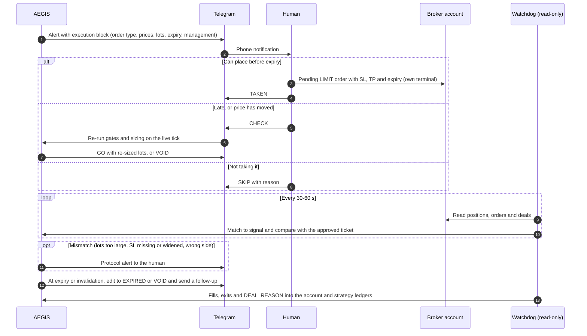

- **The account ledger** holds every position, order and deal on the account (AEGIS and manual, any symbol). It drives the real-money limits and exposure.
- **The strategy ledger** holds every approved signal. Each one is scored by `outcome_source`:
  - REAL (from fills);
  - COUNTERFACTUAL (skipped, late or expired, scored under the same contract);
  - UNFILLED.

  It drives the strategy statistics and edge monitoring.
- **Matching** is keyed by `position_id`. It uses Telegram **TAKEN / SKIP(reason) / CHECK** buttons, plus a deterministic matcher on symbol, side, an open time within [alert_sent, valid_until], and price within tolerance. A typed comment tag is optional confirmation only. Unmatched positions are `MANUAL_NON_AEGIS` and still count toward exposure.
- **The watchdog** is read-only and polls every 30–60 seconds. It alerts on:
  - volume above the approved size;
  - SL missing after a 90-second grace period, or widened;
  - TP missing;
  - the wrong side;
  - entry outside tolerance;
  - any position on any symbol without an SL (this blocks alerts with `NO_TRADE_UNPROTECTED_POSITION`);
  - manual trades while DEFENSIVE or HALTED (PROTOCOL_BREACH);
  - any `DEAL_REASON_EXPERT` deal, which must never happen in this system.

  It also checks risk at entry: lots × stop distance at the fill ≤ 1.1× planned. A 10× lot typo (0.18 → 1.80) turns 0.25% risk into about 2.4%; this is the control that catches it.
- **Hard no-execution:**
  - The AEGIS terminal logs in with the **MT5 investor (read-only) password**, and the trading password is never stored on the AEGIS machine.
  - Assert `account_info().trade_allowed == False` at startup, and fail closed otherwise.
  - A CI test fails if `order_send` or `order_check` appears anywhere in the code.

  This makes "no auto-execution" a broker-enforced fact for the AEGIS login. Your own terminal still trades, by design.

### 7.6 Limits, kill switch and edge monitoring

- **Account guards** (unchanged levels: daily 1.5%, weekly 3%, max DD 8%):
  - measured on a **cash-flow-adjusted** equity index that rebases on BALANCE/CREDIT/BONUS deals, so a withdrawal isn't a drawdown;
  - include floating P&L and manual positions;
  - day = 17:00 to 17:00 New York; week = Sunday 17:00 to Friday 17:00 New York.

  Before every alert: `realised_today + floating + open risk to SL (+ gap allowance) + new net risk ≤ daily limit`, and the same for the weekly limit. At 0.25% risk these levels equal 6R / 12R / 32R. They are capital guards (manual trades, gaps), not edge detectors: a zero-edge strategy reaches −8% within 200 trades only about 19% of the time.
- **Daily and weekly breaches** are `NO_TRADE_DAILY_LOSS` / `NO_TRADE_WEEKLY_LOSS` checks that block alerts until the next day or week boundary. They do **not** enter HALTED.
- **No separate strategy-level daily or weekly R limits** (verifier correction). Strategy protection is the defensive breaker plus the edge monitor.
- **Kill switch = HALTED**, set only by a max-DD breach.
  - Alerts are off and monitoring stays on.
  - One KILL message lists every open position with its SL status and every pending AEGIS order to **cancel now**. Live alert messages are edited to "VOID – KILL SWITCH", with a follow-up message, because edits don't notify the phone.
  - Leaving HALTED is the CLI procedure in §4.4. Then the operating mode is forced to SHADOW until 20 signals have reached OUTCOME_RECORDED.
- **Three consecutive losses** at realistic win rates is normal: P(≥ 1 run of 3 in 20 trades) is 93% at a 40% win rate and 56% even at 60%. So it is split in two:
  - **SystemMode DEFENSIVE** is driven by real taken trades on the account ledger and checked by the authorizer. Live alerts pause; signals are still recorded and scored as counterfactual outcomes. Recovery requires all of:
    1. ≥ 24h and a new trading day;
    2. a logged review checklist;
    3. the edge monitor in band.
  - **DecisionCheck CONSECUTIVE_LOSSES** on each stream's virtual ledger. It resumes by a declared, deterministic `simulated_recovery_policy` (e.g. resume after 5 trading days), so backtests and challengers don't stall. Results are reported under 2–3 alternative policies.
- **Edge monitor:** a one-sided **CUSUM** on per-trade net R against a *shrunk* backtest expectancy.
  - The winner's-curse correction matters: at N = 300 and true E = +0.10R, a passed holdout overstates E by about 95%.
  - The threshold is set by simulation for a stated false-alarm rate, and its detection time is published next to it. For reference, the review's SPRT (H0 +0.15R vs H1 0R, α = β = 0.10) needs a median of about 280 trades for a fall to 0R and about 160 for a fall to −0.10R.
  - A breach drives ACTIVE → SUSPENDED (an automatic demotion).
  - Outcome drift can't validate or invalidate the edge within the first 2–4 years. This plan says so plainly.
  - Fast operational monitors drive DEFENSIVE within weeks: spread distribution, ATR percentile, signal rate, reason-code mix vs the backtest's 99% bands, latency and shortfall.

### 7.7 Portfolio in the EURUSD-only phase (Stage 4+)

- Read **all** account positions.
- Decompose exposure into currency factors deterministically, in risk-to-stop units.
- Limits:
  - max 1 open or pending AEGIS position per symbol;
  - no opposite-direction alert while one is open;
  - total open risk ≤ 1.0% of base, including manual positions;
  - |net USD factor risk| ≤ 0.75%;
  - unprotected positions block alerts.
- Rolling correlation (V3 §28) is deferred to the multi-pair phase. A 60-day correlation has a 95% CI of [0.54, 0.81] at a true 0.70, so a 0.70 threshold flips on noise. When it arrives, use a ≥ 250-day window, a stressed ρ = 0.9 for shared legs, and hysteresis (flag at 0.75, unflag at 0.65).

---

## 8. LLM layer (replaces V3 §19–§21 and the CrewAI requirement in V3 §3; Stage 5)

**Figure 7. LLM Reviewer path.** It runs only after deterministic approval and authorization. Every outcome leaves the decision record unchanged.

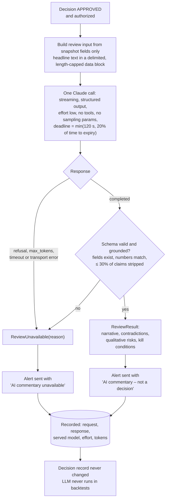

- **Placement:** one **Reviewer** call per approved and authorized decision, a few per week. Nothing in the decision core reads LLM output.
- **Purpose:**
  1. a plain-language narrative of WHAT / WHY / RISK / INVALIDATION, built only from snapshot fields;
  2. disconfirming evidence and kill conditions (Addition #9), with Python-computed contradictions such as "opposing resistance at 0.8R" listed first;
  3. qualitative risks visible only in supplied headline text;
  4. disagreement reported, never resolved (#20).

  The prompt forbids verdict and confidence wording ("strong", "high probability"). The TAKEN/SKIP rate is reported with vs without commentary, to detect anchoring.
- **Schema:** `thesis_summary` (≤ 600 characters); `supporting[]` and `contradicting[]` as `{claim, source_fields[]}`; `qualitative_risks[]` as `{category, NOTE|SERIOUS, text}`; `data_gaps[]`; `suggested_kill_conditions[]`. There are **no** status, bias, confidence or score fields. A grounding validator checks that every `source_field` exists and every number matches the snapshot within tolerance. If more than 30% of claims are stripped, the review is invalid.
- **Implementation:**
  - the official `anthropic` SDK directly;
  - model from config (`claude-opus-5-5`);
  - `output_config={"effort": "low"}` (Opus 5.5 defaults to medium); **no temperature or other sampling parameters**, since they return HTTP 400 on Opus 5.5 and SDK 1.x removed them;
  - streaming `messages.stream(..., output_format=ReviewModel)` → `get_final_message().parsed_output`;
  - `max_tokens` sized to the deadline (about 6–8k; thinking counts toward it);
  - a total deadline of `min(120 s, 20% of the time to valid_until)`;
  - retry only on connection errors or 429/529 within the deadline;
  - `stop_reason` handling: `refusal` → REFUSAL; `max_tokens` → TRUNCATED, with no retry;
  - optional server-side refusal fallbacks (`fallbacks="default"` with `betas=["server-side-fallback-2026-07-01"]`), recording the model that actually served the request;
  - zero tools;
  - untrusted headline text passed in a delimited, length-capped data block (prompt-injection defence);
  - Telegram sent as plain text with link previews off and URLs stripped from LLM text.
- **On failure**, the alert still goes out with "AI commentary unavailable" (amending V3 §54), because the LLM has no decision role. Suppressing the alert stays available as a config option (`ALERT_SUPPRESSED_LLM_INVALID`). Either way the decision record is unchanged.
- **Reproducibility** comes from recording the full request, response, served model, effort and token usage, not from temperature. Replay uses the recording.
- **Backtests:** the LLM never runs in backtests. The backtest refuses any agent output whose decision time is ≤ the model's training cutoff + 30 days. A SERIOUS flag is logged with the counterfactual outcome of the trade, so its value can be measured going forward. Realistically that takes years, so the LLM stays narrative-only unless that evidence arrives. Each model migration is a version event.
- **CrewAI** is optional, behind the same `Reviewer` interface, in a separate environment. The current CrewAI 1.15.23 cannot express adaptive thinking or effort. It forces `tool_choice` when an agent has one tool, which returns HTTP 400 on Opus 5.5. Its `[anthropic]` extra pins `anthropic~=0.73`, it has 31 mandatory dependencies, and its telemetry is on by default. If you keep it: `CREWAI_DISABLE_TELEMETRY=true`, `OTEL_SDK_DISABLED=true`, `tools=[]`, `max_iter` 1–2, an explicit timeout, and a wrapper that checks `stop_reason`.
- **Cost:** about $0.09 per review, so under $1 a month. Seven agents on every M15 cycle would cost about $1,200 a month and take 4–8 minutes per alert.

---

## 9. Alerts and notifications (Stage 4+)

**The execution block comes first.** All values are generated by `size()` and the H1 rule, and this exact message is a golden test.

The example assumes:

- a $10,000 raw account on a GMT+3 server (New York on EDT), with local time = UTC+2;
- $7 round-turn commission, 0.1-pip median spread and 0.5 pip of modelled stop slippage, so all-in cost is 1.3 pips;
- ATR14(M15) = 14 pips and a p99 overshoot of 4 pips.

The H1 signal bar closed at 12:45 UTC (08:45 New York), the alert went out at 12:46, and N = 4 bars gives an expiry of 13:45 UTC.

Working through the numbers:

- The stop floor is max(1.3/0.08, 10.5) = 16.25 pips, so the 18.0-pip stop passes at 0.072R.
- The stop is 19.2 pips net. H1's fixed net 2.0R target is 38.4 pips net (39.1 gross), so gross R:R is 2.17 and net is 2.00.
- Lots are floor($25 / $192) = 0.13.
- d_max = 0.

```text
AEGIS A-0184 | EURUSD BUY LIMIT | VALID UNTIL 16:45 server (13:45 UTC / 15:45 local, 59 min)
Entry 1.16420 | SL 1.16240 | TP 1.16811 | Lots 0.13 (do not round up)
Risk at SL incl. costs $24.96 = 0.25% | Gross R:R 2.17 | Net R:R 2.00 | Stress risk (p99 gap) 0.30%
Set order expiry 16:45 server. If it has not filled by expiry it is void: do not chase.
Market BUY: not allowed for this strategy (fixed net 2.0R target, d_max = 0)
Cancel before fill if: M15 closes below 1.16254 (invalidation)
Next tier-1 event: US CPI 12:30 UTC tomorrow (outside this signal's life)
Management: set-and-forget; time stop 16:00 NY (20:00 UTC)
Account now: 1 manual GBPUSD (0.30%); open risk after this trade 0.55%
STATUS: HUMAN REVIEW REQUIRED – not an instruction to trade
[TAKEN] [SKIP] [CHECK]
```

- **Below the execution block** come the diagnostics: rule stats card, contradictions and AI commentary, regime, spread vs baseline, news status, invalidation, created/expires.
  - The **rule stats card** shows OOS N, net expectancy with a 95% CI, win rate with a Wilson CI, max DD and test period. It never shows a score as a probability.
  - **Historical statistics:** no number is shown without N, period, 95% CI and IS/OOS status. Subgroup rates are shown only after Beta-binomial shrinkage toward the pooled rate.
- **Lifecycle:**
  - At expiry or invalidation the message is edited to EXPIRED/VOID *and* a short follow-up is sent.
  - Alerts with under 10 minutes of validity are suppressed.
- **Delivery:**
  - Operational alerts go to a separate chat.
  - Telegram is notification-only: a chat_id allowlist and no control commands except the TAKEN/SKIP/CHECK callbacks.
  - The alert and an **outbox row** are written in one DB transaction before sending; the decision record was already persisted at DECIDED. A retry after a timeout confirms or edits rather than resending; any resend is labelled "DUPLICATE OF A-0184".
  - The send deadline and live-tick re-check are as in Figure 2b.
- **External dead-man's switch:** every cycle pings an off-box heartbeat. Silence raises "AEGIS SILENT", so "no trades" and "dead system" can be told apart.

---

## 10. Statistical validation protocol (replaces V3 §43–§49 and the V3 §64 targets)

### 10.1 Objective

- **Primary objective:** on development data only (the walk-forward OOS folds of §10.3), select the pre-registered configuration with the highest lower 95% confidence bound of net expectancy per trade, subject to the drawdown and risk limits. The historical holdout is a single pass/fail test of that frozen choice (§10.4) and is never optimised on. Report a winner's-curse-adjusted estimate next to it.
- **Win rate** is reported with a Wilson CI, never targeted. At a 2R target with binary TP/SL exits, a real +0.10–0.25R edge means a win rate of about **37–42%**, so **most alerts will lose**. With H1's same-day time stop many trades end as SCRATCH, and the TP-hit rate can be far lower: about 5–22% on synthetic data in the review. Plan your psychology and alert fatigue around that.
- **False positive** is defined as an approved alert closing ≤ 0R net. It is reported, not targeted.

### 10.2 Power and sample size

Computed for 80% power with a one-sided 5% test. SD of trade R is about 1.47R at 2R with binary exits, and about 1.2R with time stops.

| True edge | Required N_eff, SD 1.47 | SD 1.2 |
|---|---:|---:|
| +0.10R | 1,336 | 891 |
| +0.15R | 594 | 396 |
| +0.20R | 334 | 223 |
| +0.25R | 214 | 143 |
| +0.40R | 84 | 56 |

- Pre-register the MDE (suggested: +0.15R) and the SD assumption (1.47R unless Part A says otherwise).
- **N_eff:** a cluster is (trading day 17:00–17:00 New York, USD direction of the trade).
  - *Returns-blind (pilot, Part B):* N_eff = the number of distinct clusters containing ≥ 1 signal, times the fill-rate assumption stated in Part A. This is a conservative lower bound.
  - *After returns are seen:* N_eff = N / (1 + (m̄ − 1)·ρ̂), where m̄ is the mean number of trades per cluster and ρ̂ is the intra-cluster correlation of net R estimated on development data, floored at the cluster count.
  - Six USD majors are worth about 2.4–4.4 independent pairs.
- **If the holdout can't reach the required N_eff, the outcome is `NOT_EVALUABLE`.** That is never GO. Extend the history or the universe under a new Part A, or state the achieved power explicitly.

### 10.3 Splits

- **Development: 2010-01-01 to 2022-06-30.**
  - Initial training 2010–2013, then **eight** 12-month test folds 2014–2021, anchored and expanding. 2022-H1 is reported as a short ninth fold but not counted.
  - The strategy rules stay frozen; only declared parameters are re-selected per fold.
  - Purge every training candidate whose label interval overlaps the test fold, with an embargo of at least the maximum holding period.
  - Features use trailing windows only.
  - If pre-2012 data is unusable for any pair: start in 2012, train on 2012–2014, use seven folds 2015–2021, and change the gate to E > 0 in ≥ 6 of 7 folds.
- **Historical holdout: 2022-07-01 to 2026-06-30**, pooled across the six majors.
  - Part B records the hashes. The holdout is opened exactly **once** by `scripts/run_g3.py`, which refuses a second run without a recorded "burn".
  - Report a per-regime breakdown, with no re-tuning afterwards.
  - It is a different monetary regime (ECB hikes after mid-2022), which is a useful robustness test.
  - It is *not* free of designer look-ahead: you and the LLMs you've chatted with already know the 2020–2026 EURUSD path.
- **Excluded:** data from 2026-07-01 to the design freeze is excluded from every test.
- **Forward lockbox:** paper and shadow data collected after the design freeze. It is the only designer-blind data. It has low power, so it is a gross-failure and consistency check with pre-registered bounds, not proof.

### 10.4 Gates

**Figure 8. Validation protocol.** The holdout is opened once. A failed development gate means it is never opened.

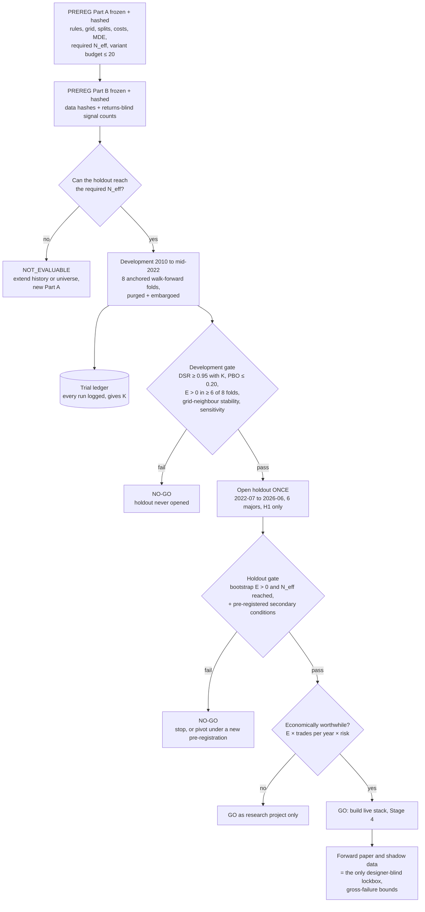

**Development gate** (before the holdout is opened; development data only):

- deflated Sharpe ratio ≥ 0.95, with K from the trial ledger (t ≥ 3 if K is uncertain);
- PBO (CSCV, S = 8–16) ≤ 0.20;
- E > 0 in ≥ 6 of 8 folds, with no fold contributing > 40% of total R;
- **stability (V3 §48/§49):** report the full grid surface; the selected configuration must have E > 0 in at least half of its face neighbours (±1 grid step per parameter), otherwise it is flagged as overfit and the gate fails;
- **sensitivity:** perturb the fixed constants one step and report all of them:
  - ATR/RSI 14 → 10 / 20;
  - tier-1 window ±30 → 20 / 45 min;
  - spread multiplier 1.5 → 1.25 / 2.0;
  - stop floor 0.75 → 0.5 / 1.0 ATR;
  - cost cap 0.08 → 0.06 / 0.10R;
  - order expiry N 4 → 2 / 6;
  - the recovery policy.
- **cost and delay stress** may be moved here from the holdout gate (see below).

**Holdout gate** (one shot; no multiplicity deflation **only because exactly one configuration of one hypothesis, H1, is opened**):

1. **Binding:**
   - a one-sided stationary block bootstrap of mean net R per trade > 0 at α = 0.05. It resamples trading days in blocks, each day carrying all its trades, with the mean block length set by the Politis–White rule and 10,000 resamples;
   - **and** achieved N_eff ≥ the pre-registered required N_eff (otherwise NOT_EVALUABLE).
2. **Pre-registered secondary conditions:**
   - E > 0 at **+50% spread and 2× slippage** (in R units by stop-size bucket), with the lower bound > −0.05R;
   - E above the 95th percentile of the B0 null;
   - E > 0 with entry delayed **+5 minutes**;
   - the EURUSD-specific shrunk estimate > 0 and not below the pooled estimate − 1 SE, because live alerts are EURUSD-first.
3. **Joint power:** before the holdout is opened, simulate the joint pass probability of 1 and 2 at the MDE. Either size N_eff for the joint gate, or move the cost, null and delay conditions into the development gate. Record the choice in Part A or Part B.
4. **Reported only, not a pass condition:** cluster-resampled Monte Carlo p95 max DD at 0.25% and 0.50% risk.

**Economic worthwhileness** (your decision, §15 Q5):

- Report the expected return: E × trades/yr × risk%.
- Suggested bar for going beyond research: ≥ 12R a year expected, about 3% a year at 0.25%.
- Below that, run AEGIS as a research and learning project, or raise frequency (more live pairs).

### 10.5 Controls

- **Trial ledger:** every backtest is auto-logged to `research/trial_ledger.jsonl` with config hash, data hash, code commit, N, N_eff, E, SD, skew and kurtosis. K is reported next to every result.
- **Labels for every candidate:** approved, blocked (with reason code), skipped, paused and unfilled all get a triple-barrier outcome on M1/tick bid/ask with the same cost model. The *system outcome* is stored separately from the *human-executed outcome*. Without this, the outcome table is selection-biased and ablation is impossible.
- **Ablation admission rule** (#18, #29):
  - A candidate component is admitted only if a paired bootstrap of per-trade net R differences over all pooled OOS trades has a 95% lower bound > 0 after a Holm correction, with max DD non-inferior. Default: excluded.
  - A looser "better in 3 of 4 folds" rule admits a do-nothing filter about 24% of the time, which is why it isn't used.
  - Hard safety gates (news, spread, anomaly, sizing, limits, kill switch) are **exempt**: they are judged on tail metrics such as worst-trade R and p95 slippage, not mean R.
- **Reporting:** every metric shows N, N_eff, point estimate, block-bootstrap CI, period, regime and IS/OOS status, plus a winner's-curse-adjusted expected live value. The template is `reports/VALIDATION_TEMPLATE.md`.

---

## 11. Staged roadmap with go/no-go gates (replaces V3 §66)

Assumes one developer working 10–15 hours a week with Claude Code, using the stated scope. The weeks are estimates; re-estimate bottom-up in Stage 0. Every stage ships with its own tests (there is no separate "testing phase"), and V3 §67's per-stage report stays.

**Figure 9. Roadmap with go/no-go gates.** Nothing beyond the research backtester is built until G3 says GO.

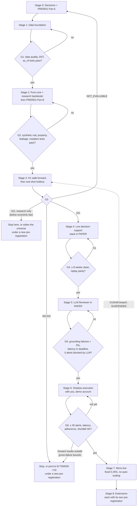

| Stage | Calendar weeks (cumulative; stages overlap) | Build | Exit gate |
|---|---|---|---|
| **0 · Decisions + Part A** | 1 | §15 answers; PREREG Part A; account facts; trial ledger skeleton; repo/CI | Part A committed and its hash logged before any research code reads prices |
| **1 · Data foundation** | 1–4 | MT5 M1 + tick export and depth probe (Windows); Dukascopy M1 bid/ask; `tier1_events.csv`; Parquet PIT store with `as_of`; UTC/DST layer on the broker grid; spread model; gap/overshoot/rollover stats; forward collectors if the Windows machine is available | **G1:** median abs(broker M1 bid close − Dukascopy M1 bid close) ≤ 0.3 pip over the overlap, 07:00–17:00 London; missing M1 in liquid hours ≤ 0.1%; DST tests pass (2026/2027 windows, 10 known releases per year); H4 grid alignment test passes; snapshot-builder future-poisoning test passes; `tier1_events.csv` matches the MQL5 export on ≥ 99% of 2015+ events; depth report written |
| **2 · Pure core + research backtester** | 3–8 | `core/`, `strategies/trend_pullback_v1.py`, `sim/`, `drivers/backtest.py`, `drivers/replay.py`, `research/metrics.py`, trial ledger; then `scripts/count_signals.py` and **Part B** | **G2:** on synthetic driftless M1 bid/ask data (`sim/synthetic.py`) with the production cost model, random 1R/2R entries with no time stop give WR = 1/3 ± 1pp and mean net R = −cost ± 3 SE (≈ ± 0.025R at 30k trades); with a time stop, mean net R = −cost ± 3 SE. Batch = incremental indicators. Property, NaN/inf, leakage (decide-level poisoning, lag, truncation) and golden tests pass. mutmut ≥ 90% killed on gates/sizing/limits. Part B committed |
| **3 · H1 test** | 6–12 | Walk-forward, DSR/PBO, stability and sensitivity, baselines B0–B4, ablations, cost/delay stress, Monte Carlo; exploratory H2/H3/B-TSMOM on development data; then **one** holdout run | **G3: GO / GO-research-only / NO-GO / NOT_EVALUABLE** per §10. A GO is permission to collect forward evidence, not proof |
| **4 · Live stack in PAPER** *(only if GO)* | +6–8 | Windows VPS; MT5 adapter (investor login, `trade_allowed` assertion, `maxbars`, offset checks); scheduler with DB unique constraints; SQLite (WAL) + SQLAlchemy Core + Alembic (§14 schema); outbox; Telegram; state machines; authorizer; watchdog; monitoring (§11.4); dead-man's switch; replay; security (§11.5); `docs/DEPLOY.md` | **G4:** ≥ 8 weeks with every cycle accounted for and no unexplained operational failure; replay parity (recorded snapshot → same outcomes and reason codes on Windows and Linux); spread-uplift calibration report; PSI parity in band; one rebuild of a fresh VPS from `docs/DEPLOY.md` |
| **5 · LLM Reviewer in PAPER** | +2 | `agents/anthropic_reviewer.py`, grounding validator, recordings | **G5:** grounding failures < 5%; p95 latency within the deadline; zero alerts blocked by the LLM |
| **6 · Shadow execution with you** (demo account) | until ≥ 30 alerts: about 15–43 weeks at 0.7–2 EURUSD alerts a week (fewer if more validated pairs are alerted) | Execution contract live; TAKEN/SKIP/CHECK; reconciler; operator metrics | **G6 (an operations gate; it can't confirm the edge):** ≥ 30 alerts; p90 alert-to-order latency < median validity window; ≥ 90% adherence; risk at entry ≤ 1.1× planned on every trade; zero watchdog breaches; implementation shortfall measured (target ≤ 0.10R/trade); forward results within the pre-registered gross-failure bounds |
| **7 · Micro-live** | — | Small dedicated account, fixed 0.25%, all guards on | Scaling only by version change after predefined criteria (V3 §52); never automatic. A CUSUM breach → SUSPENDED → back to research |
| **8 · Extensions** (each with its own pre-registration) | — | Meta-labelling challenger; H2 confirmatory; more live pairs (re-enable correlation); Tier-2 data; champion/challenger streams; drift monitors | Admission by §10.5 only. A challenger is promoted only on its own untouched holdout or forward data (a paired ΔE with a sequential boundary), never on the already-opened holdout |

**Time to the first pre-registered historical test.** The review's estimate was about 7–10 weeks for a minimal research scope (about 80 hours raw), and the verifier judged even that optimistic. Stages 1–2 as specified add the PIT store, the tier-1 table, the DST and broker-grid work, the mutation-tested core and the labeller. Expect more than 10 weeks and re-estimate in Stage 0. It is still far earlier than about 22–33 weeks under V3's order. If G3 says NO-GO, the data, cost model and backtester are reusable for the next hypothesis.

**Forward evidence is slow.** At 0.7–2 signals a week per pair, pooled across six majors, 100 effective forward signals take roughly 6.5–10 months.

**Figure 10. Stages 0–3: build sequence and artefacts.** Returns are first computed only after PREREG Part B is committed.

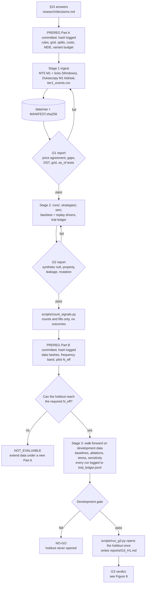

### 11.1 Definition of done, Stages 0–3

Each stage is done when these files exist and these commands pass.

- **Stage 0:**
  - `research/PREREG.md` (Part A);
  - `research/PREREG_LOG.md` (the hash table);
  - `research/decisions.md` (your §15 answers);
  - `research/account_facts.yaml`: broker, regulator and leverage, account type and currency, commission per lot, and per symbol: digits, point, contract size, volume min/step/max, stops level, server-time rule;
  - `research/trial_ledger.py`, with an empty append-only `trial_ledger.jsonl`;
  - `pyproject.toml` with a hash-locked research environment;
  - CI running ruff, an import-linter contract for `core/`, and pytest.
- **Stage 1:**
  - `data/raw/<source>/…` (Parquet/JSONL) plus `data/MANIFEST.sha256`;
  - `config/instruments.yaml`;
  - `research/tier1_events.csv`;
  - `reports/G1_data_quality.md`, with one row per G1 metric (value, threshold, PASS/FAIL);
  - the time and PIT-store tests green;
  - structured JSON logging from this stage on.
- **Stage 2:**
  - `aegis_fx/core`, `strategies/trend_pullback_v1.py`, `sim/`, `drivers/backtest.py`, `drivers/replay.py` and `research/metrics.py`;
  - `reports/G2_backtester_validation.md`;
  - `reports/VALIDATION_TEMPLATE.md`;
  - `pytest -m "unit or property or leakage or golden"` green;
  - the mutmut report;
  - PREREG Part B committed.
- **Stage 3:**
  - `scripts/run_g3.py` writes `reports/G3_H1.md`, with one row per §10.4 item (value, CI, threshold, PASS/FAIL, N, N_eff, K);
  - the exploratory reports for H2/H3/B-TSMOM;
  - the burn record of the holdout;
  - the V3 §67 stage report.

### 11.2 V3 §63 acceptance (amended)

This is assessed only after G3 = GO, at the Stage 6 exit, via `docs/READINESS.md`:

| V3 §63 area | How it is shown |
|---|---|
| Architecture | G2 static and import checks |
| Data | G1 |
| Analysis | The engines used by the frozen strategy are deterministic and tested; diagnostic engines (fundamental, sentiment, regime, confluence) are computed and logged |
| Risk | G2 property and mutation tests, plus G4 |
| AI | G5 |
| Testing | Unit, integration and failure-injection tests pass; backtest, walk-forward, holdout, Monte Carlo and sensitivity complete at G3 |
| Operations | G4, plus runbooks: restore drill, kill-switch reset, VPS rebuild |
| Validation | G6, with zero critical safety failures |

There is one new precondition: G3 = GO. Even then, per V3 §68, nothing is claimed beyond these criteria.

### 11.3 V3 §65 required outputs, by stage

| V3 §65 output | Where it is produced |
|---|---|
| #1–2 | Structure and source: §4.2, per stage |
| #3–4 | Requirements and pyproject: Stage 0 (research), Stage 4 (live) |
| #5 | `.env.example`: Stage 4 |
| #6–7 | Config and schemas: Stages 1–2 |
| #8 | DB schema: Stage 2 (research store) and Stage 4 (§14) |
| #9 | CrewAI agent definitions → replaced by the Reviewer prompt + ReviewModel, Stage 5 (CrewAI adapter optional) |
| #10–14 | Engines: Stages 1–2 for H1's needs; fundamental, sentiment and regime as Stage 4+ diagnostics |
| #15 | Confluence: `core/score.py` (diagnostic), Stage 4 |
| #16–18 | Risk, portfolio and safety gate: `core/` (Stage 2) + `risk/authorizer.py` (Stage 4) |
| #19 | Telegram: Stage 4 |
| #20–22 | Backtesting, walk-forward and Monte Carlo: Stages 2–3 |
| #23 | Monitoring: Stage 4 |
| #24 | Logging: structured JSON from Stage 1 |
| #25–27 | Tests: every stage |
| #28 | README: Stage 0, updated each stage (including the minimum-equity table) |
| #29 | `docs/DEPLOY.md`: Stage 4 |
| #30 | `reports/VALIDATION_TEMPLATE.md`: Stage 2 |
| #31 | `docs/READINESS.md`: drafted in Stage 4, signed off at the Stage 6 exit |

### 11.4 Monitoring (V3 §53, Stage 4)

**Blocking checks** (failure sets SYSTEM_HEALTH = FAIL, so no alerts):

- MT5 terminal and connection;
- tick and bar freshness;
- account read;
- calendar fetch age;
- DB write;
- scheduler heartbeat;
- broker-offset and NTP check.

**Warn-only** (operational chat, no effect on alerts):

- the Claude API and CrewAI (a Reviewer failure means "AI commentary unavailable");
- the COT, rates and sentiment collectors (handled by the input-role table);
- Telegram (the outbox retries, and the dead-man's switch covers total silence);
- disk, memory and CPU above configured thresholds;
- cycle latency vs the send deadline.

None of these produce trading alerts.

### 11.5 Security (V3 §55, Stage 4)

- **Secrets:** ANTHROPIC_API_KEY, TELEGRAM_BOT_TOKEN, the MT5 investor password, and the heartbeat and backup credentials live only in the environment or a `.env` outside the repo, with owner-only ACLs.
  - `.env.example` ships the names with empty values.
  - Startup refuses empty or placeholder values.
  - The MT5 trading password is never stored on the VPS.
- **Access:** RDP only via VPN or an IP allowlist with MFA. There is an outbound firewall allowlist: broker servers, api.anthropic.com, api.telegram.org, NTP, the heartbeat and backup targets.
- **Maintenance:** a key-rotation runbook (quarterly, and immediately on suspicion); pip-audit and secret scanning in CI; encrypted off-box backups.
- **Release:** LIVE/MICRO_LIVE are refused on a dirty git tree, unlocked dependencies, or (if CrewAI is installed) missing `CREWAI_DISABLE_TELEMETRY`/`OTEL_SDK_DISABLED`.

---

## 12. Testing (extends V3 §60)

- **Property tests (Hypothesis): gate monotonicity in the risk direction.** If `gate(x)` is NO_TRADE, then `gate(worse(x))` is NO_TRADE for spread↑, minutes-to-event↓, data age↑, net R:R↓, open risk↑, drawdown↑ and free margin↓. Band properties apply to volatility.
- **Invalid values:** NaN, None or ±inf in every numeric field gives NO_TRADE with ERROR, including after canonicalisation (§4.3).
- **v1 boundary matrix (replaces the V3 §61 rows).** Each pair below is one case just failing and one just passing:
  - net R:R 1.999 vs 2.000;
  - cost ratio 0.081 vs 0.080R;
  - stop one point below vs at the floor;
  - news T−31 vs T−30 min;
  - spread 1.5× baseline + 1 point vs equal;
  - lots one step below `volume_min`;
  - valid_until −1 s vs +1 s;
  - open risk 1.0% + 1 cent;
  - send deadline ±1 s.

  All gates passing → APPROVED.
- **Sizing invariants in integer steps:**
  - lots are a multiple of the step;
  - actual risk ≤ target;
  - below the minimum lot → reject;
  - a forced minimum lot is rejected at $500 equity with a 20-pip stop and at $1,000 with 35 pips;
  - a non-USD account currency case.
- **Mutation testing (mutmut)** on gates, sizing and limits: ≥ 90% of mutants killed.
- **Golden decision files:** any diff requires a `strategy_version` bump, enforced in CI (V3 §59). Golden alert message (§9).
- **Replay and parity:** recorded snapshot → identical outcomes and reason codes on **both** Windows and Linux.
- **Failure injection** (V3 §60 plus, Stage 4+):
  - Telegram timeout after delivery;
  - a 10× lot fill;
  - a missing SL;
  - a manual position on another symbol;
  - a broker offset change;
  - a cancelled tier-1 event;
  - an event rescheduled into the ±30-min window;
  - a calendar-down hour;
  - an LLM refusal or timeout (the alert still goes out, the decision is unchanged);
  - DB write failure (no alert, by construction);
  - restart in every persisted mode (the mode survives).
- **State-machine tables** over all (state, event) pairs.
- **DST and time:**
  - the 2026 and 2027 mismatch windows;
  - with an NFP at 12:30 UTC on a GMT+3 server, the M15 bar labelled 15:30 server time (12:30 UTC) must be blocked, and the bar labelled 12:30 server time (09:30 UTC) must not be;
  - the Christmas thin session and the Sunday open;
  - H4 grid alignment.
- **Leakage:** future-poisoning (snapshot level in G1, decide level in G2), truncation, lag-sensitivity, and the LLM-cutoff refusal.
- **Static checks:** forbidden imports in `core/`; ruff bans `datetime.now` / `time.time` in `core/`; `order_send` / `order_check` grep.

---

## 13. What happens to each of the 30 additions

| # | Addition | Verdict | Where it lands |
|---|---|---|---|
| 1 | Uncertainty engine | MODIFY | Keep only data completeness and quality as a binary hard gate. The other six sub-scores have no mapping to outcomes. |
| 2 | Signal quality ≠ probability | KEEP | The alert shows OOS expectancy with a CI; score ≠ probability (§9, §10). |
| 3 | Historical analogue engine | DEFER, as a display | A descriptive panel at most ("20 nearest past cases: W/L, median R, Wilson CI"), strictly time-respecting (neighbour exit < query time − embargo), ≤ 4 trailing-normalised features, and *not* used in decisions. |
| 4 | Regime-specific models | MODIFY | Report every metric by regime, with shrinkage. Gate only through a pre-registered binary filter (H1's trend condition) or §10.5. In ChatGPT's own example, only Strong vs Range is significant. |
| 5 | Strategy selection engine | DEFER | One strategy first. A second enters later as a challenger with its own pre-registration. |
| 6 | Evidence hierarchy | KEEP, made structural | Only Tier A/B (PIT) inputs may gate, score or size; Tier C/D (LLM) are narrative only. |
| 7 | Data disagreement engine | MODIFY | Deterministic components only. The V3 §18-style conflict (H4 trend vs rate-differential direction) is logged per candidate as a diagnostic (Stage 4+) and becomes a gate only via §10.5. No agreement or conflict score over LLM outputs. |
| 8 | Minimum evidence floors | MODIFY | The non-compensatory idea is adopted via binary rule conditions (§7.2). If a score ever gates, floors are fixed a priori or must pass §10.5. |
| 9 | Disconfirming evidence | KEEP | Python-computed contradictions plus the invalidation price in every alert; the LLM adds narrative (§8). |
| 10 | Uncertainty budget | DROP | Duplicates #1/#13/#14, with about 9 more tunables. |
| 11 | Calibration testing | KEEP, when probabilities exist | Calibration slope and intercept, 5 quantile bins, *economic* calibration (predicted vs realised net R), paired log-loss vs base rate. |
| 12 | Probability shrinkage | KEEP | Beta-binomial with prior strength 30–50 toward the pooled rate; hierarchical normal for expectancy (κ ≥ 50). |
| 13 | Novelty detector | DEFER / fold into #14 | If built: Mahalanobis distance (Ledoit-Wolf covariance) against the training fold, flagged above its 99th percentile. "Similarity 22%" has no definition. |
| 14 | Market anomaly detector | MODIFY | Three deterministic checks with a-priori thresholds (§7.2): spread percentile by hour of week, ATR percentile, gap or extreme bar. Correlation and cross-asset anomalies deferred. |
| 15 | Execution-quality prediction | MODIFY | A deterministic executable net R:R from measured costs plus stress, and lots recomputed at the actual price (`/check`). Latency and liquidity models wait for shadow data. |
| 16 | Signal decay model | MODIFY | Binary VALID/VOID triggers (valid_until, price beyond d_max, invalidation price, tier-1 window start, spread spike) replace the invented 100→40 curve. The expectancy-vs-delay and fill-vs-expiry curves are *measured* in the backtest (§7.3) and used to fix N and d_max. Price-dependent gates are re-checked at send time. |
| 17 | Outcome attribution | MODIFY | Deterministic tags only (stop within ±30 min of a release, spread at exit > 2× baseline, MFE ≥ 1R before loss, time-stop exit). No LLM narrative attribution; no per-component conclusions below about 100 outcomes. |
| 18 | Ablation testing | KEEP (key) | Pre-registered paired ablations with the §10.5 admission rule. |
| 19 | Agent contribution scoring | DEFER | Can't be done historically (LLM look-ahead); forward scoring would take years at this signal rate. Descriptive per-model stats only. |
| 20 | LLM disagreement protocol | KEEP | Reported, never resolved; never thresholded in Python. |
| 21 | Reason codes on every decision | KEEP | The canonical Check × Outcome scheme (§4.3), including PASS vectors for rejected candidates. |
| 22 | Decision replay | KEEP | An automated replay test, exact in integer units (§4.3, §12). |
| 23 | Shadow-model comparison | DEFER, but architect now | `strategy_id`/`version` in every key from day 1; separate decision streams and virtual ledgers (role OBSERVER). |
| 24 | Champion/challenger | DEFER, but architect now | Only CHAMPION+ACTIVE passes the authorizer. Promotion is manual, against criteria pre-registered with the challenger: a paired ΔE on the same candidate stream, on its own untouched holdout or forward data with a sequential boundary. Never on the already-opened holdout. A 0.10R improvement needs about 678 paired trades per arm. |
| 25 | Drift detection | MODIFY | Fast *input* monitors (PSI with fixed bands on monthly snapshots) plus one slow outcome CUSUM with published detection time (§7.6). Demotion only. |
| 26 | Strategy retirement | MODIFY | ACTIVE / SUSPENDED / RETIRED driven by the CUSUM plus manual sign-off. Automatic demotion yes, automatic promotion never. |
| 27 | Cost-aware optimisation | KEEP (key) | +25% / +50% spread and 2× / 3× slippage, *in R units by stop-size bucket* (§10.4). |
| 28 | Stress scenarios | KEEP | One consolidated failure-injection suite (§12). |
| 29 | Minimum viable complexity | KEEP (governing rule) | The complexity budget plus the ablation admission rule (§3, §10.5). |
| 30 | New objective | MODIFY | The single objective in §10.1: selection on development folds only; the holdout is pass/fail. The undefined "uncertainty ≤", "novelty ≤" and "confluence ≥" constraints are dropped. |

The upgraded architecture diagram has two fixes. The LLM layer moves from *before* confluence to *after* deterministic approval. And Telegram comes *before* human review, because the human reviews the Telegram alert. V3 §1 has the same ordering slip.

---

## 14. Smaller V3 corrections

- **V3 §3:**
  - Python **3.12–3.13** x64; numpy 2.5 needs ≥ 3.12, and CrewAI, if kept, needs < 3.14.
  - The MetaTrader5 package ships **Windows-only** wheels (5.0.6231, win_amd64). Live runs and the MT5 history export need Windows. Research, backtests and CI run anywhere, because `core/` never imports MT5.
  - pandas-ta can't be installed (the numba pin).
  - CrewAI is optional.
  - Pin hash-locked requirements after compatibility testing.
- **V3 §6:** H4 history ≥ 1,000 bars (the minimum of 500 stays for the other timeframes).
- **V3 §7:** a concrete freshness table with a test per row:
  - tick ≤ 10 s in active sessions;
  - bar = the expected last completed bar per the session/holiday calendar (missing inside a known thin session → `NO_TRADE_MARKET_CLOSED`, not STALE);
  - account read in the same cycle;
  - calendar fetched ≤ 15 min ago covering [now − 2h, now + 48h];
  - (later) COT ≤ 10 days (13 with a holiday); yields ≤ 1 business day + lag.
- **V3 §17:** PRIME undefined → research label only.
- **V3 §20:** the confidence scale (V2 0–100 vs V3 0–1) is moot; LLM output has no confidence field.
- **V3 §21:** "low temperature" isn't possible on Opus 5.5; reproducibility comes from recording (§8).
- **V3 §22:** "limit" = the configured target risk; never round up to the minimum lot.
- **V3 §32:** the recovery condition is defined (§7.6).
- **V3 §35:** the conjuncts as in §2.1; thresholds read from config (they are hard-coded as 90 and 2.0).
- **V3 §38, extended. Tables:**
  - `decision_records`: one row per cycle with the full CheckResult vector and the strategy/config/code/schema hashes;
  - `snapshots`;
  - `alerts_outbox`, with an idempotency key and status;
  - `cycle_states`;
  - `system_mode_events`;
  - `account_ledger`: positions, orders and deals, including manual ones;
  - `strategy_ledger`: per approved signal, with `outcome_source` REAL | COUNTERFACTUAL | UNFILLED, `deal_reason`, `management_plan_id` and adherence;
  - `candidate_labels`: the system outcome for every candidate;
  - `llm_reviews`: request, response, served model, effort, tokens;
  - `trial_ledger`.

  `component_scores` is kept as diagnostics (Stage 4+); `agent_reports` is replaced by `llm_reviews`. Unique constraints enforce V3 §56. Time is stored as UTC epoch milliseconds.
- **V3 §43 / §64:** replaced by §10.
- **V3 §57:** replaced by §4.4.
- **V3 §62, operating modes and permissions.** No mode can call `order_send`.

| Mode | Data | Human-facing alerts | Notes |
|---|---|---|---|
| RESEARCH | Historical only | None | Stages 0–3 |
| PAPER | Live | None (decisions recorded only) | Stages 4–5 |
| SHADOW | Live | Alerts marked "SHADOW – DO NOT TRADE LIVE" (demo account only) | Stage 6, and forced after a max-DD reset until 20 signals have reached OUTCOME_RECORDED |
| MICRO_LIVE | Live | Alerts | Its own risk cap; Stage 7 |
| LIVE_DS | Live | Alerts | After micro-live criteria are met |

---

## 15. Decisions needed from you

Stage 0 needs answers to 1–8; question 9 can wait until G3.

1. **Purpose and time:** income or research/learning? How many hours a week (the timeline assumes 10–15)?
2. **Broker and account:** broker and regulator (which sets leverage), raw/ECN or standard, account currency, starting equity, commission per lot. These go into `research/account_facts.yaml`. Minimum equity at 0.25% is about $530–$1,450, depending on stop size.
3. **A Windows machine for Stage 1:** the MetaTrader5 package is Windows-only. Can you run MT5 on a Windows PC or VPS during market hours from Stage 1, for the history export and forward collectors? If not, research uses Dukascopy only and the collectors start in Stage 4.
4. **Execution hours:** which local hours can you act on alerts? This sets which live signals are paper-only; the research window is fixed in PREREG.
5. **The pre-registered numbers:** do you accept MDE +0.15R (80% power, one-sided 5%, SD 1.47R), the §10.3 dates, and the economic bar of ≥ 12R a year (§10.4)? For context:
   - at 0.25% risk, V3's likely 10–25 signals a year would earn about 0.25–1.6% a year even with a real edge;
   - H1's design band is 0.7–2 signals a week per pair, about 36–104 a year on EURUSD alone, or roughly 0.9–6.5% a year at +0.10–0.25R. That is an upper bound before unfilled orders, missed alerts and shortfall;
   - Stage 3's measured frequency replaces both figures.
6. **Stage 3 scope:** H1 as the only confirmatory test, with H2, H3 and B-TSMOM exploratory? And pooled research on six majors with EURUSD-first alerts, or alerts on every pair that validates (portfolio limits then switch on)?
7. **NO-GO commitment:** will you accept NO-GO or NOT_EVALUABLE and stop, or pivot under a new pre-registration, rather than tune until something passes?
8. **Repository and data terms:**
   - Build in a new dedicated repository (recommended) or in `aegis-fx/` here, inside `brazilian-real-estate-analysis`?
   - Are you comfortable with Dukascopy's terms for personal research use?
   - Any budget for Tier-2 data? None is needed for Stages 0–3.
9. **Later, at G3:** a Windows VPS and an MT5 investor (read-only) password for the AEGIS terminal; and drop CrewAI, or keep it as an optional adapter?

## 16. Immediate next steps

1. Answer §15 Q1–Q8 (rough answers are fine).
2. Freeze PREREG Part A from §5, with your edits.
3. I build Stages 1–2 (data foundation, PIT store, pure core, research backtester, G1/G2 reports) in the repository you choose, and report per V3 §67.
4. Commit Part B, run Stage 3 once, and decide.

---

## Appendix A. Glossary

- **R:** one unit of planned **net** risk, i.e. the loss if the stop is hit including costs (|entry − SL| + commission + expected slippage + expected negative swap). +2R means twice that amount was won.
- **E:** mean net R per trade (the expectancy).
- **All-in cost (pips):** hour-of-week median spread + round-turn commission + expected slippage. This one definition is used by the stop floor, the cost-ratio gate and G2.
- **WR:** share of trades that hit TP. Break-even WR at a 2R target with binary exits is 1/3.
- **IS / OOS:** in-sample (data used to choose anything) / out-of-sample (data not used).
- **PIT:** point-in-time, a value as known at time t.
  - `available_at`: when a value became knowable.
  - `as_of(t)`: reads only records with `available_at ≤ t`.
  - **Designer look-ahead:** you, or an LLM, already know how the period turned out.
- **MDE:** minimum detectable effect, the smallest true E the test is built to detect with 80% power at one-sided α = 0.05. The required sample is n = ((1.645 + 0.842)·SD / MDE)².
- **N_eff:** effective sample size after clustering (§10.2).
  - **Design effect** = 1 + (m − 1)ρ, for clusters of m trades with intra-cluster correlation ρ.
- **K:** the number of distinct configurations backtested on development data (the trial ledger).
- **Walk-forward (anchored):**
  - fit on all data up to a date, test on the next 12 months, extend, repeat;
  - **purge:** drop training trades whose outcome window overlaps the test fold;
  - **embargo:** a further gap of at least the longest holding time.
- **DSR (deflated Sharpe ratio; Bailey & López de Prado 2014):** the probability that the true Sharpe ratio is above zero after correcting for K trials, the sample length, and the skewness and kurtosis of returns. DSR ≥ 0.95 ≈ "significant at 5% after accounting for the search".
- **PBO (probability of backtest overfitting; Bailey, Borwein, López de Prado & Zhu 2017):** estimated by **CSCV** (combinatorially symmetric cross-validation). Split the development period into S blocks; for every way of choosing half the blocks as in-sample, find the best configuration in-sample and check its rank out-of-sample. PBO is the share of splits in which it falls below the out-of-sample median.
- **Stationary block bootstrap (Politis & Romano 1994):** resampling blocks of consecutive trading days with random, geometrically distributed lengths, which preserves dependence between nearby trades.
- **Triple-barrier label:** a trade's outcome is whichever is hit first: TP, SL, or the time limit.
- **Wilson CI:** a confidence interval for a proportion that behaves well at small N.
- **Holm correction:** a step-down Bonferroni adjustment for testing several hypotheses.
- **Winner's curse / shrinkage:**
  - estimates that passed a selection step are biased upward;
  - shrinkage pulls small-sample estimates toward a broader baseline, e.g. Beta-binomial for win rates and a hierarchical normal model for E.
- **CUSUM:** a sequential test that accumulates evidence of a drop in E and signals when the cumulative sum crosses a threshold.
- **SPRT:** the sequential probability ratio test (used for the review's reference numbers).
- **PSI (population stability index):** Σ (actual% − expected%)·ln(actual%/expected%) over bins. Bands: < 0.10 stable, 0.10–0.25 watch, > 0.25 drift.
- **d_max:** the largest adverse entry deviation that keeps net R:R ≥ the floor: (T_net − 2·S_net)/3 for a 2.0 floor.
- **Implementation shortfall:** the system's (counterfactual) R for a signal minus the R you actually realised on it.
- **Tier-1 event:** an event on the fixed whitelist in §7.2.
- **Counterfactual outcome:** the outcome a signal would have had under the execution contract when it wasn't taken. Recorded so the statistics aren't selection-biased.
- **Champion / challenger / observer:**
  - *champion:* the strategy whose signals are alerted;
  - *challenger:* runs on the same data for comparison only;
  - *observer:* logs decisions with no promotion path.
