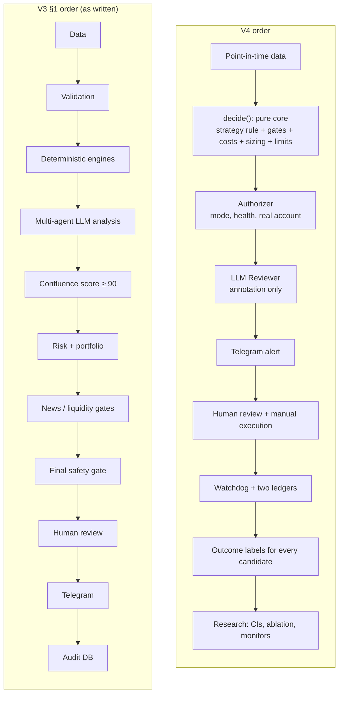
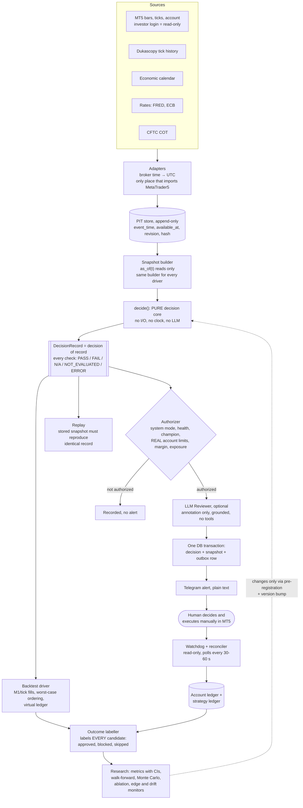
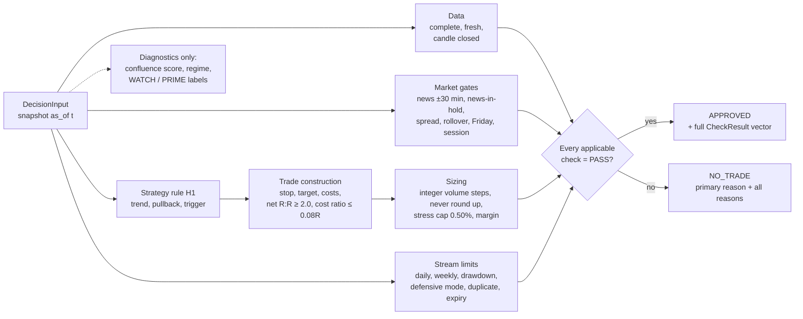
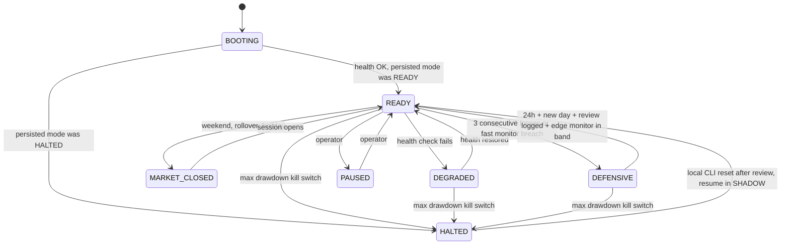
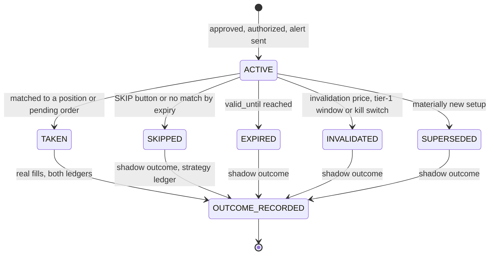
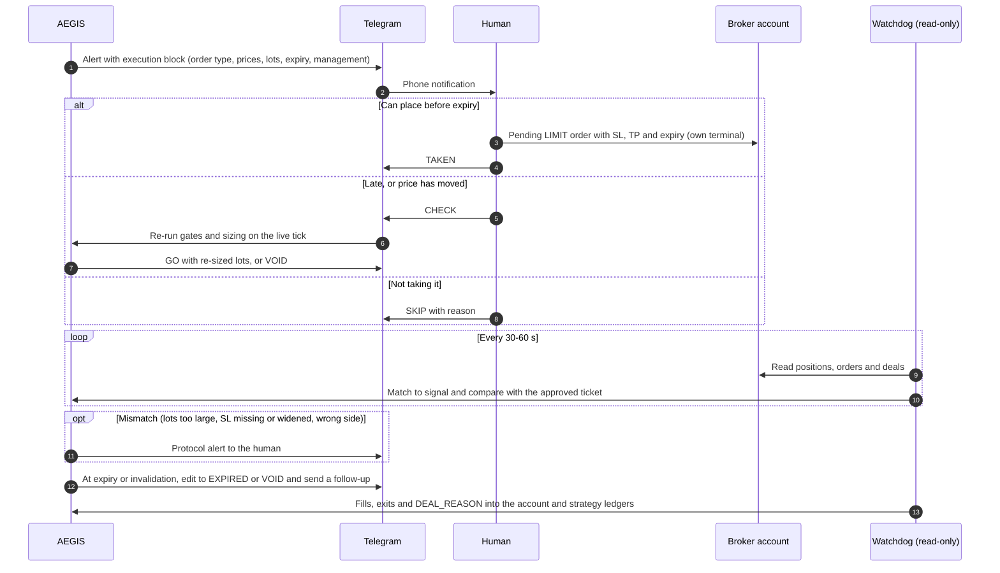
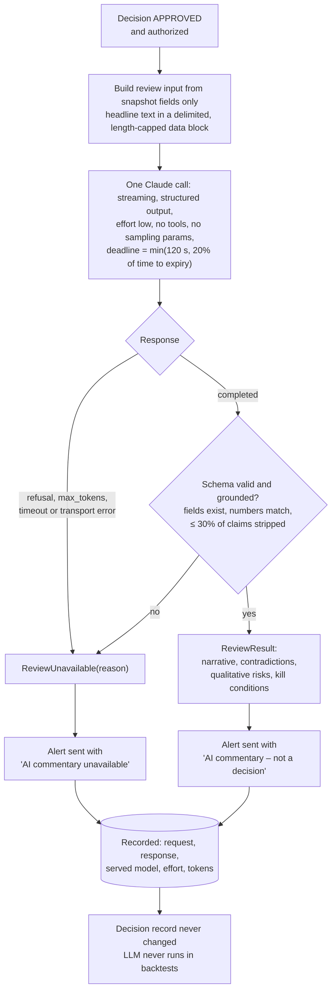
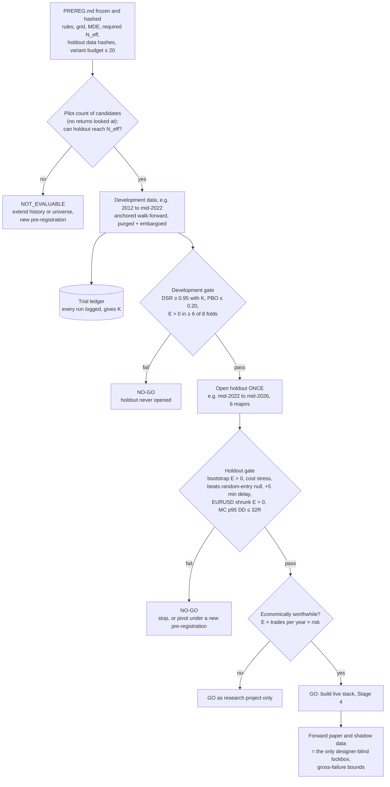
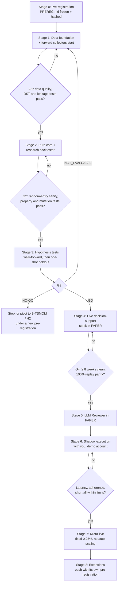

# AEGIS-FX V4 — Revised Plan

*Built on the AEGIS-FX V3 Master Build Specification. Date: 2026-10-06.*

This plan **amends V3**. Where they conflict, this plan wins. Anything V3 says that this plan doesn't touch stays as written. The evidence behind every change is in [`REVIEW.md`](REVIEW.md). That review was five independent critiques (statistics, data, risk/execution, architecture/LLM, red team). Each one went to an adversarial verifier, who re-ran the numbers and fact-checked roughly 100 claims.

Nothing here claims the system is profitable, accurate, low-risk or production-ready (V3 §68). The plan is designed to find out, cheaply and honestly, whether an edge exists. It only builds the live system if one does.

---

## 1. Verdict on V3 and the 30 additions

**V3 is a strong safety specification wrapped around a strategy that doesn't exist yet.** Its doctrine is right and is kept: Python calculates, the LLM never authorises, fail closed, completed candles only, structured gate results, versioning, and no auto-execution. As a plan to *find and deliver an edge*, it has four critical flaws:

| # | Problem | Why it matters |
|---|---|---|
| 1 | **No strategy is defined.** There is no entry trigger, stop formula, target rule, time exit or session. | The backtest, walk-forward and sample-size rules (§40–§49) have nothing fixed to test. Whoever writes the code invents the strategy, and every choice made along the way is an unrecorded degree of freedom. |
| 2 | **The live decision rule can't be validated.** The confluence components you can compute from price and spread sum to 70. Reaching 90 needs ≥20 of the 30 fundamental + sentiment points, and V3 names no point-in-time (PIT) source for them. The LLM agents sit *before* confluence. | An LLM reading a historical date already knows what happened next. Claude Opus 5.5's training cutoff is June 2026, so only about 3 months of clean data exist. The system you could backtest is not the system that would send alerts. |
| 3 | **Sample sizes are unreachable.** EURUSD-only with 19 conditions ANDed together gives roughly 5–25 qualifying signals a year (an estimate). | 500 historical signals would take 20–100 years. Showing a +0.15R edge with 80% power needs about 590 *effective* trades. |
| 4 | **Build order.** Backtesting comes at phase 14 of 18. | About 22–33 part-time weeks pass before the first genuine out-of-sample (OOS) result, versus about 7–10 weeks research-first. These are assumption-driven estimates, but the direction is clear. The backtest also ends up bolted onto the live engine. |

Two further HIGH-severity gaps:

- **The step between alert and trade is undefined.** V3 has no order type, entry tolerance, expiry, trade management, or link between the human's MT5 trades and signals. Live results would not be comparable with the backtest.
- **The objectives don't fit together.**
  - A 60–68% win rate at net R:R ≥ 2 means at least +0.8R per trade, an annual Sharpe of about 2.7–4.6. Break-even at 2R is a 33.3% win rate.
  - The "false-positive <20–30%" target contradicts the win-rate target.
  - Even a *real* edge of +0.10–0.25R at 10–25 trades a year and 0.25% risk earns only **about 0.25–1.6% a year**.

**The 30 additions.** About 8 are strong and kept, including #18 ablation, #27 cost stress, #29 minimum complexity, #21/#22 reason codes and replay, #12 shrinkage and #2 evidence ≠ probability. About 10 are useful once modified. About 12 add roughly 100 tunable thresholds that make overfitting *more* likely and contradict #29; those are deferred or dropped (full table in §13). One finding matters most: a single researcher iterating over 100–1,000 variants on pure noise can produce +0.17 to +0.32R in-sample expectancy. That is exactly the size of a plausible real edge.

**My answer to "do you have a better idea":** yes. Treat AEGIS as a **research programme with a delivery system attached**, not as a delivery system that will be validated afterwards:

1. Freeze one simple, falsifiable strategy before looking at any data.
2. Test it with a leakage-free backtester across a pool of pairs.
3. Decide GO / NO-GO with numbers fixed in advance.
4. Only then build the MT5 → Telegram → human loop, sharing the *same* decision code.

The LLM becomes a narrator and red-teamer that runs after the deterministic decision.

**Figure 1. What changes in the order of operations.** V3 §1 puts LLM analysis *before* confluence and human review *before* Telegram. V4 keeps the LLM out of the decision of record and closes the loop back to research.



---

## 2. Kept from V3 unchanged

- **Doctrine:** §1, §2.1 and §2.2 (AI interprets, Python calculates and enforces), §69.
- **Data handling:**
  - §5: per-record source, timestamps and quality status, with Pydantic at every boundary.
  - §6: forming vs completed candle, and the validation checks.
  - §56: process each completed candle exactly once, keyed by timestamp.
- **Gates and risk rules:**
  - §35: a single deterministic gate that returns structured reasons, never a bare Boolean.
  - §54: fail-closed defaults.
  - §61: the boundary test style (89 vs 90).
  - §22–§23: deterministic sizing that rounds down; base risk 0.25%; no risk increase for higher confluence.
  - §26: all R:R rules on **net** values.
  - §31: the kill switch needs a manual reset, and the LLM can't reset it.
  - §33–§34: signal validity and duplicate prevention as first-class data.
- **Governance:**
  - §39 and §59: versioning, and change → backtest → validation → approval → version bump.
  - §44–§45: sample sizes and CIs on every claim (the targets are restated in §10).
  - §62: modes, none of which can auto-execute.
  - §67–§68: phase reporting and no false certification.

---

## 3. The ten design decisions

1. **The strategy is the product.** A pre-registered, frozen rule (§5) is what everything else exists to test and then deliver.
2. **Research before infrastructure.** Nothing past the research backtester is built until a hypothesis passes a numeric gate (§11).
3. **One decision core, two drivers.** A pure function `decide(snapshot, config, ledger) → DecisionRecord` is called by both the backtest driver and the live driver, plus a replay tool. No live/backtest re-implementation.
4. **A point-in-time contract.** Only inputs with a leakage-free history may gate, score or size. Every record carries `available_at` (the time it became knowable), and every read is `as_of(t)`.
5. **A non-compensatory rule instead of a 100-point gate.** The v1 gate is the strategy's binary conditions plus the hard risk/data gates. The confluence score is still computed and stored, but only as a diagnostic until it is calibrated against outcomes. The alert shows the rule's measured OOS expectancy with a CI, never a score dressed as quality.
6. **The LLM is outside the decision of record.** One structured Claude call runs *after* deterministic approval. It narrates, lists disconfirming evidence and flags qualitative risks. It never runs in backtests and never changes a decision.
7. **Model and measure the human.** Every signal carries an execution contract (order type, tolerance, expiry, management plan). Two ledgers separate strategy outcomes from account reality. A read-only watchdog checks what was actually placed.
8. **A statistical protocol, not targets.** Pre-registration, an auto-logged trial ledger, a minimum detectable effect with a power calculation, a one-shot holdout, CIs on everything, and a matched random-entry null.
9. **Capital protection is separate from edge monitoring.** Drawdown limits and the kill switch protect money. A separate sequential test (CUSUM) watches the edge, and its detection times are published.
10. **A complexity budget.** v1 allows at most 8 signal-selecting tunables, at most 3 per hypothesis. Nothing new enters the decision path without winning a pre-registered ablation.

---

## 4. Architecture

### 4.1 Flow

**Figure 2. System architecture.** One pure decision core is shared by the backtest, replay and live drivers. Only the authorizer can create an alert. The LLM sits after it and can't change the decision.



### 4.2 Module layout (V3 §4 kept where it works, with additions)

```text
aegis_fx/
  core/            # NEW, pure. CI forbids imports of MetaTrader5/anthropic/telegram/sqlalchemy/httpx
    types.py  reasons.py  indicators.py  structure.py  regime.py
    gates/{data_quality,news,spread,session,volatility}.py
    costs.py  sizing.py  limits.py  portfolio.py  signal_lifecycle.py
    decide.py      # the decision of record
  strategies/      # NEW: base.py (Strategy protocol), registry.py, trend_pullback_v1.py
  data/            # adapters + PIT store (replaces "fetch and compute" modules)
    mt5_adapter.py  calendar_source.py  rates_source.py  cot_source.py
    pit_store.py  snapshot_builder.py  data_quality.py
  drivers/         # NEW: live.py, backtest.py, replay.py
  sim/             # NEW: fills.py, ledger.py, labeller.py
  risk/            # authorizer.py, account_ledger.py, watchdog.py, reconciler.py
  agents/          # reviewer.py (interface), anthropic_reviewer.py, [crewai_reviewer.py optional]
  schemas/  storage/  notifications/  monitoring/  app/  config/  scripts/
  research/        # replaces backtest/: metrics, walk_forward, monte_carlo, ablation,
                   # trial_ledger, prereg, reports
  tests/{unit,property,integration,failure_injection,replay,backtest}
```

### 4.3 Two check families and one canonical reason scheme

**Figure 3. Inside `decide()`.** Every check is evaluated (no short-circuit). Approval needs every applicable check to pass. The confluence score is a diagnostic, not a gate.



- **DecisionCheck** is evaluated inside `decide()`. It covers data, setup, market gates, costs, sizing, and the stream's virtual-ledger limits. Every check is evaluated (no short-circuit) and produces `CheckResult(check, outcome, observed, threshold, unit, detail)`.
- **AuthorizationCheck** is evaluated only in `risk/authorizer.py`. It covers SYSTEM_MODE, SYSTEM_HEALTH, STRATEGY_AUTHORITATIVE, real-account daily/weekly/max-DD limits, real margin and exposure, and unprotected positions. Challenger and shadow streams therefore still produce full decision records.
- **Outcomes:**
  - PASS.
  - FAIL.
  - NOT_APPLICABLE: the component isn't part of this strategy. It is excluded from the approval condition.
  - NOT_EVALUATED: a required check that couldn't run. Fails closed.
  - ERROR: fails closed.

  `approved ⇔ every applicable check is PASS`.
- **Reason strings** are derived (`NO_TRADE_<CHECK>`, `PASS_<CHECK>`, `FAIL_<CHECK>`, as Addition #21 asks) from **one enum module**. A test asserts that every emitted code is a member, upper-case and unique. V3's names are kept as aliases:
  - `NO_TRADE_DRAWdown` → `NO_TRADE_MAX_DRAWDOWN`;
  - `NO_TRADE_LLM_OUTPUT_INVALID` and `NO_TRADE_INVALID_LLM_OUTPUT` → the alert-stream status `ALERT_SUPPRESSED_LLM_INVALID`;
  - `SIGNAL_EXPIRED` and `NO_TRADE_EXPIRED` → `NO_TRADE_SIGNAL_VALID`.
- **New codes V3 is missing:**
  - `NO_TRADE_POSITION_SIZE` (below minimum lot; never round up);
  - `NO_TRADE_KILL_SWITCH`;
  - `NO_TRADE_DAILY_LOSS` and `NO_TRADE_WEEKLY_LOSS` (§35 has no daily or weekly conjunct as written);
  - `NO_TRADE_DEFENSIVE_MODE`;
  - `NO_TRADE_NEWS_IN_HOLD`;
  - `NO_TRADE_ROLLOVER`;
  - `NO_TRADE_UNPROTECTED_POSITION`;
  - `NO_TRADE_COST_RATIO`;
  - `NO_TRADE_MARKET_CLOSED` (this one is not an error);
  - `NO_TRADE_LATE` (send deadline passed).
- **Integer canonicalisation.** Every value a gate compares is converted before comparison: prices and distances to integer points, lots to integer volume steps, money to cents, scores to integers. This makes replay exact across Windows (live) and Linux (CI), where float last-bits differ. It also kills the NaN fail-open bug: `NaN > limit` is False in Python, so `if x > limit: fail` would pass a NaN.

### 4.4 Two-level state machines (replace V3 §57)

- **SystemMode** is persisted and restored on boot, so a crash can never clear a kill switch.
  - `BOOTING` → `READY`.
  - `READY` ↔ `DEGRADED`, automatic and driven by health checks.
  - `READY` → `DEFENSIVE`: entered automatically; left only through the recovery rule in §7.6.
  - `PAUSED`: manual in, manual out.
  - `HALTED` (the kill switch): leaving it requires a **local CLI command** that records operator, reason and time. Never via Telegram or the LLM.
  - `MARKET_CLOSED`: weekend, rollover and holiday sessions. It is never treated as STALE and never raises operational alerts.
  - ERROR is not a state. The process exits and the supervisor restarts it.
- **CycleState**, one per (strategy, version, symbol, bar_time). Each cycle ends in a terminal state and is idempotent: `DETECTED → SNAPSHOT_OK | SNAPSHOT_FAILED → DECIDED{APPROVED|NO_TRADE} → REVIEWED | REVIEW_UNAVAILABLE → ALERT_QUEUED → ALERT_SENT | ALERT_FAILED | ALERT_SUPPRESSED`.
- **Entity lifecycles:**
  - Signal: `ACTIVE → EXPIRED | INVALIDATED | SUPERSEDED | TAKEN | SKIPPED → OUTCOME_RECORDED`.
  - Strategy: `CANDIDATE | ACTIVE | SUSPENDED | RETIRED` × `CHAMPION | CHALLENGER | SHADOW`. Automatic transitions are demotions only. Promotion is a manual, recorded, version-bumping act.
- Every machine is an explicit transition table, tested over all (state, event) pairs.

**Figure 4. SystemMode (persisted).** Daily and weekly loss breaches are checks that block alerts until the next boundary; they are not modes.



**Figure 5. Signal lifecycle.** Every signal ends with an outcome, including skipped and expired ones (scored as shadow outcomes), so the statistics are not selection-biased.



---

## 5. Strategy and hypotheses (Stage 0 pre-registration)

Write `research/PREREG.md`, commit it, and record its git hash **before any research code loads price data**. It must contain:

- the exact rules;
- at most 3 free parameters per hypothesis, each on a 3-value grid;
- the label definition and cost model;
- the data splits;
- the baselines;
- the acceptance criteria (§10);
- the minimum detectable effect (MDE) and the resulting required effective N;
- the expected signal frequency, measured on development data across the whole grid *before* looking at returns;
- a variant budget of at most 20 named variants.

### H1 (primary): H4 trend / M15 pullback continuation, London–New York overlap

This is a draft. Edit it if you like, then freeze it.

- **Universe:** research pooled over EURUSD, GBPUSD, USDJPY, AUDUSD, USDCAD, USDCHF, with rules in ATR units. Live alerts stay EURUSD-first.
- **Window:** M15 bars closing 08:00–11:30 America/New_York (DST-aware). Shift it to hours you can actually act in. Signals outside your hours are logged as paper-only.
- **Trend (H4, completed bars):** close > EMA200(H4) and EMA50(H4) > EMA50(H4) six bars earlier, mirrored for shorts. On synthetic data this filter is true about 80% of the time, which is weak. Consider adding "last two H4 swing lows rising".
- **Pullback:** RSI14(M15) ≤ L at some point in the last W M15 bars, while the trend holds.
- **Trigger:** M15 close > prior M15 high, and RSI14(M15) > 50.
- **Entry:** a BUY LIMIT at the trigger close (see the execution contract in §7.3). The backtest fills it only on trade-through.
- **Stop:** the lowest low of the last W bars − 0.1×ATR14(M15). Reject the setup if `stop_pips < max(all_in_cost_pips / 0.08, 0.75×ATR14(M15))` or `stop_pips > 25`. This keeps costs at or below 0.08R. At 1.0 pip all-in cost, a 6-pip stop costs 0.17R, a 10-pip stop 0.10R and a 15-pip stop 0.07R.
- **Target:** a fixed **net 2.0R** for research. A structural take-profit is a later, separately pre-registered variant.
- **Time stop:** flat at T_exit. At most 1 trade per pair per day. Management is set-and-forget (§7.3).
- **Grid (27 configurations):** L ∈ {35, 40, 45}, W ∈ {6, 8, 12}, T_exit ∈ {12:00, 14:00, 16:00 NY}. Constrain the grid by a frequency band of 0.7–2 signals per week per pair, measured before returns are seen. Report the exit mix (TP / SL / time stop).
- **Falsified if** the holdout fails the §10 criteria.

### H2 (secondary): post-release drift, with no consensus data needed

- **Events:** NFP, US CPI, FOMC and ECB decisions, about 40 a year.
- **Rule:** at T+D (D ∈ {30, 45, 60} min), let m = close(T+D) − open(T−1 min). If |m| ≥ k×ATR14(M15) measured before the event (k ∈ {1.0, 1.5, 2.0}), enter in the direction of m.
- **Exits:** the stop at the opposite extreme of the T..T+D range plus 0.1×ATR; take-profit at net 2R; time stop at T+6h.
- **Unit of analysis:** the event. Pooling pairs adds little N here, because one event drives all of them.
- **Gate exception:** a scoped exception to the §13 post-news-volatility block for H2 entries only; the spread gate still applies.
- **Sample:** about 220 events over 2012–2026, so H2 is mainly a historical test with its own MDE. If it passes, it is the cleanest replacement for V3's 20-point "fundamental alignment".

### H3 (diagnostic): Asian-range mean reversion

- **Purpose:** a regime contrast. If trend continuation works and range fading doesn't, that is *evidence* for H1's trend filter, not an assertion.
- **Expected conflicts:** with the 2R floor, and with manual execution at night.

### Benchmark B-TSMOM: daily time-series momentum on the same six majors

- **Rule:** the sign of the 3–12-month return, volatility-targeted, rebalanced weekly.
- **Why include it:** it has the best-documented FX evidence, and it fits a human-in-the-loop cadence naturally (about one decision a week). It is the sanity check on whether intraday complexity is worth it, and a fallback product if H1 fails.

### Baselines every hypothesis must beat (paired where possible)

| Baseline | Construction |
|---|---|
| B0 | Matched random entry: same pairs, session, trades/day, stop distribution, TP multiple, time stop, costs; 1,000 seeds. The hypothesis must exceed the null's 95th percentile. |
| B1 | Trend direction with random timing inside the window. Isolates the value of the M15 trigger. |
| B2 | Naive trend-follow: enter at window open in the H4 direction with the same exits. |
| B3 | The trigger without the news/spread/regime filters. This is Addition #18's ablation; each filter must earn its place (§10.5). |
| B4 | Do nothing: 0R after costs. |

Simple FX technical-rule profits largely disappeared after the early 1990s (Olson 2004; Neely, Weller & Ulrich 2009). A NO-GO is a realistic outcome, and it is an acceptable one.

---

## 6. Data plan (point-in-time)

### 6.1 Tier 1: free, needed for the first research cycle

| Source | Use | PIT / timing rule | Traps |
|---|---|---|---|
| Broker MT5 M1 bars + ticks (`copy_ticks_range`) | Truth for the period they cover; spread model; live parity | bar close; tick time | Set **Max bars in chart = Unlimited** and restart. The default of about 100k bars gives only ~1.3 years of M5. Assert `terminal_info().maxbars` at startup. Archive once to Parquet with SHA-256 hashes and diff later re-downloads. The bar `spread` field is the **per-bar minimum**, so never use it for costs or baselines. |
| Dukascopy bid/ask ticks (EURUSD from 2003, UTC) | Long research history | tick time | Tighter than a retail account: use mid-prices plus a broker-calibrated spread model by hour of week. Write a reconciliation report; if >5% of trade outcomes flip between sources, long-history results are supplementary only. Check the terms of use (personal research). |
| MQL5 economic calendar (export via an MQL5 script; EUR/USD, high + medium, 2015+) | News blackout times; event list for H2 | scheduled and actual release time | Archive times use the server's *current* DST for all past events, so half the history is off by one hour. Convert with the export-time offset, and unit-test 10 known releases per year in both DST halves. "Previous" is revised and the "forecast" provenance is unknown, so surprise scores stay out of v1. Events get cancelled or merged (Oct 2025 CPI cancelled; Oct payrolls merged with Nov). |
| FRED DGS2; fed funds target (DFEDTAR before 2008-12-16, DFEDTARU/L after); ALFRED vintages | Rate differential; first-release macro values | DGS2 usable from the next business day | Join daily series as of the **previous** day's publication. A same-day join leaks up to a day. |
| ECB 2-year spot yield (from 2004-09-06), deposit facility rate | Euro-area leg of the differential | next TARGET day, 12:00 CET | — |
| CFTC COT, TFF + Legacy, Euro FX 099741 | Slow positioning feature (diagnostic) | as of Tuesday, **released Friday 15:30 ET**; usable from Friday 15:30 ET (in practice the Sunday open) | Keep an exceptions table: holidays, and the 2025 shutdown (no reports 1 Oct–12 Nov; backlog cleared 29 Dec 2025, so the as-of-30-Sep report came about 50 days late). Treat as stale after 10 days (13 with a holiday). |

### 6.2 Tier 2: later, and only through an ablation win

- Consensus forecasts with PIT history: Trading Economics sells a point-in-time calendar; test that first.
- Retail positioning: start a **forward collector on day 1** (Myfxbook allows 100 requests/24h free). OANDA position books can be probed back to 2015 if you have an account.
- Newswire archives; OIS/futures-implied policy paths.
- None of these enters a gate or score until it has at least 12 months of PIT history **and** wins a pre-registered ablation.

### 6.3 Contract and tests

- **Bitemporal records:** `event_time, available_at, retrieved_at, source, source_version, content_hash`, plus `vintage/revision` for revisable series only. There is a per-source availability-rule table.
- **Input-role table** in config, one row per input:
  - `MANDATORY`: UNAVAILABLE → `NO_TRADE_MISSING_DATA:<input>`;
  - `SCORED`: the component is renormalised or the signal is ineligible (chosen once, in advance);
  - `VETO_ONLY`: unavailable means no veto;
  - `NOT_APPLICABLE`.

  The same table applies in backtest and live. A 7-week COT outage then has a defined effect instead of a silent one.
- **Tests:**
  - *future poisoning:* replace every record with `available_at > t` by noise; `decide(t)` must not change;
  - *lag sensitivity:* add +1 bar to every `available_at` and report how many decisions change;
  - *truncation:* every derived feature (ATR percentile, regime, spread percentile) must be identical whether history ends at t or today. That means trailing windows only and filtered (one-sided) regimes;
  - *feature parity:* the live score uses exactly the backtest feature definitions. A weekly PSI between paper and backtest component distributions raises `DRIFT_PARITY` when > 0.2.

### 6.4 Time

- **Storage and clocks:**
  - Store UTC everywhere.
  - Configure `broker_tz_rule`, for example "NY close: America/New_York + 7h", the common GMT+2/+3 convention.
  - At startup and hourly: `offset = round((last_tick.time − NTP_UTC_now) / 3600)` during liquid hours. Fail closed on a mismatch or an unexpected change. The Python docs say UTC, but observed timestamps are broker wall-clock time.
  - Tick age is measured as `NTP_UTC + rule offset − last_tick.time`, never re-deriving the offset from the same tick.
  - NTP poll ≤ 3,600 s; the Windows standalone default is 7 days.
- **Sessions, windows and expiry:**
  - Sessions use Europe/London and America/New_York via `zoneinfo`.
  - The trading day is 17:00 New York to 17:00 New York.
  - Unit-test the US/EU DST-mismatch windows: 2026 has 8–29 Mar and **25 Oct–1 Nov, which starts 19 days from today**.
  - MT5 order expiry is entered in **broker server time**, so alerts print server time first.
- **Spread baseline:**
  - The baseline is the time-weighted mean of the 1-second-resampled quoted spread over the trailing 24h, excluding 16:55–17:30 New York and the first 15 minutes after the weekly open. Store an hour-of-week percentile next to it. Log V3's literal raw 24h mean alongside it and compare the two in paper trading before adopting.
  - Raw/ECN accounts: allow a 0.0 spread and gate on all-in cost (spread + commission).
  - Reject crossed quotes, missing values and anything above a hard cap.

### 6.5 Storage

- **Raw inputs:** append-only Parquet for ticks and bars, JSONL for calendar, COT, rates and LLM I/O, with a SHA-256 manifest. Roughly 0.1–2.5 GB a year for EURUSD; trivial.
- **Snapshots:** self-contained compressed snapshots for every candidate at WATCH or above and every alert; hash references are fine for routine NO_TRADE cycles.
- **Backups:** nightly and encrypted, with a monthly restore drill.

---

## 7. Decision core, risk and execution

### 7.1 Indicators

- Implement in-house (about 150 lines of numpy):
  - EMA, SMA-seeded;
  - Wilder RSI and ATR;
  - swings, structure and BOS with documented definitions.
- Test against golden reference values, and test that batch and incremental results are equal to 1e-12.
- **pandas-ta can't be used.** Its latest release pins numba 0.61.2, which requires numpy < 2.3, so it can't be installed alongside numpy 2.5.
- **History:** at least **1,000 H4 bars**, so the window choice doesn't matter. With 300 bars the EMA200 error is about 3.6 pips median and 9.4 pips at the 95th percentile; with 500 it is about 0.5 / 1.4; with 1,000 it is about 0.
- **Python:** 3.12–3.13 x64. numpy 2.5 needs ≥ 3.12; CrewAI, if kept, needs < 3.14.

### 7.2 Gates and the score in v1

- **Gates:** data quality and freshness; candle closed; the hypothesis's binary conditions; the news blackout; news-in-hold; the spread gate; the rollover block; the Friday cutoff; the cost ratio; net R:R ≥ 2.0; position size; limits; duplicates; expiry.
  - The **news blackout** is ±30 min around a fixed, versioned **tier-1 whitelist** (NFP, US CPI, FOMC decision and press conference, ECB decision and press conference; optionally EZ flash HICP, US retail sales, GDP advance). Vendor "importance" is stored as metadata only.
  - **News-in-hold:** a tier-1 event inside [now, valid_until + p75 holding time] gives `NO_TRADE_NEWS_IN_HOLD`. With a 24h horizon this removes about 15% of signal times at 40 events a year; report the share.
  - The **rollover block** is 16:45–17:30 New York.
  - The **Friday cutoff:** no new entries after Fri 12:00 UTC.
- **Confluence score (V3 §15–§16):** computed and stored for every candidate with PIT-feasible components.
  - Fundamental: the 2-year differential level and change, plus policy-rate direction.
  - Sentiment: publication-lagged COT plus a 1-day-lagged VIX regime.

  It is *not* a gate in v1, because its weights and the 90 cut-off have no measured meaning. First measure how correlated the components are on the real candidate set. Simulation shows RSI14 and (close−EMA)/ATR correlate at about 0.95–0.99 on the same timeframe.
  - **Later calibration:** map score bands to empirical net R with CIs.
  - **Meta-labelling challenger (Stage 8):** at most 8 de-duplicated, trailing-normalised features; L2-logistic regression or a monotone GBM of depth ≤ 2; purged and embargoed CV; Platt calibration; the threshold chosen on validation folds only. It enters only by beating the champion on the §10 rules.
- **Tiers:**
  - one live alert tier;
  - WATCH and PRIME are database labels for research only;
  - no priority push;
  - no risk scaling. The PDF's "0.25–0.50% dynamic by tier" is withdrawn, consistent with V3 §23.

### 7.3 Execution contract (new; versioned with the strategy and printed in every alert)

- **Order type:**
  - Pullback or range entries: BUY/SELL LIMIT at entry.
  - Breakout or retest entries: BUY/SELL STOP LIMIT, with the limit at the stop price ± d_max.
  - A market order is allowed only through `/check`, which re-runs the gates and re-sizes on the live tick.
- **Entry tolerance:** `d_max = (T_net − 2·S_net)/3`, the largest adverse entry deviation that keeps net R:R ≥ 2.0. It is printed as an absolute price ("do not buy above 1.16431"). On a 12-pip stop it is only 0.9 pip at net 2.2R and 2.2 pips at 2.5R, which is why market entries after a phone delay are dangerous.
- **Expiry:** `valid_until = min(signal bar close + N bars, next tier-1 window − 15 min, rollover start, Friday cutoff)`. The human sets the same broker-side expiry on the pending order. Alerts show server time, UTC, local time and a countdown.
- **Management v1, SET-AND-FORGET:**
  - SL and TP are placed broker-side with the order; no mental stops;
  - no break-even moves, partials or trailing;
  - a time stop;
  - Friday flat at 19:00 UTC unless the backtest, including gap risk, says otherwise;
  - one rule for tier-1 events during an open trade, chosen and backtested in advance.

  Any time-stop or Friday parameter is fitted inside walk-forward training folds only.
- **Outcome classes:**
  - WIN = TP hit;
  - LOSS = result ≤ −0.5R;
  - SCRATCH = everything else.

  Adherence is measured automatically from the exit deal's `DEAL_REASON`: SL/TP means the plan was followed; CLIENT/MOBILE/WEB before the planned exit means it wasn't.
- **Backtest fills:**
  - limits fill only on trade-through (buy limit when Ask ≤ limit);
  - stops fill at the worse of the stop price and the post-gap open;
  - if SL and TP fall in the same bar, resolve on M1/ticks, or assume SL first;
  - report the share of tie-breaks.
- **Entry delay stress:** re-run with entry at +2, +5 and +10 minutes. Net expectancy must stay > 0 at +5 minutes (§10).

### 7.4 Sizing and costs (replaces the V3 §22 formula)

- **Base and budget:** `base = min(balance, equity − credit)`, read in the same cycle as sizing. `risk_money = base × 0.25%`.
- **Prices:** entry is the executable side (Ask for buys, Bid for sells), so the spread enters through price levels only.
  - Long SL/TP sit at Bid-chart levels.
  - A short SL sits at structure + ATR buffer + the p95 spread for the hours it may be live.
  - A short TP sits at structure + the median spread.
- **Loss per lot:** `loss_1lot = −order_calc_profit(side, symbol, 1.0, entry, sl) + commission_rt + E[stop slippage]`. The fallback is integer ticks × `trade_tick_value_loss`; never mix this with the contract_size path.
- **Lots:** floored in **integer volume steps** (Decimal floor). A naive `floor(x/0.01)` gets 1,076 of 10,000 two-decimal values wrong. Cap at `volume_max` and a policy cap.
- **Below the minimum lot:** `lots < volume_min` → `NO_TRADE_POSITION_SIZE`. **Never round up.** Assert `lots × loss_1lot ≤ risk_money`; the "limit" in §22 means the 0.25% target.
- **Minimum equity:** forcing 0.01 lot into a 0.25% budget is impossible below about **$530 / $850 / $1,450** of equity for 12 / 20 / 35-pip stops. Rounding error stays ≤ 10% only above about $5.4k / $8.6k / $14.6k.
- **The 0.50% ceiling gets a job:** the stress cap. `lots × (loss_1lot + p99 overshoot × pip value) ≤ 0.50% of base`. Realised loss is (S+g)/S R: a 10-pip overshoot on a 12-pip stop is 1.83R, and the April 2017 French-election open gapped about 200 pips. Measure the weekend-gap and tier-1 overshoot distributions in Stage 1.
- **Net values:**
  - `net_risk = |entry − SL| + commission_rt + E[slippage] (+ expected negative swap)`;
  - `net_reward = |TP − entry| − commission_rt (− swap)`.
  - Gross 2.0R is only about 1.61–1.90R net on 8–35-pip stops.
  - Swap comes from `symbol_info` (`swap_long/short`, triple-swap day). The backtest models historical swap from the rate differential plus a calibrated markup, stressed ±50%. Snapshot the real swap values daily from day 1.
- **MARGIN_SAFE:**
  - `free_margin − order_calc_margin(...) ≥ 0`;
  - projected margin level ≥ a floor calibrated **together** with the open-risk cap. At 1:30 with 10-pip stops, 1.0% open risk already means about 295% margin level;
  - fail closed if `order_calc_margin` returns None.

### 7.5 Two ledgers, watchdog and the hard no-execution control

**Figure 6. The human execution loop.** AEGIS never places orders. Its terminal is logged in read-only, and it verifies what the human actually placed.



- **The account ledger** holds every position, order and deal on the account (AEGIS and manual, any symbol) from `positions_get / orders_get / history_deals_get`. It drives the real-money limits and exposure.
- **The strategy ledger** holds every approved signal. A taken signal is scored from its real fills; a skipped or late one is scored as a SHADOW outcome under the same contract. It drives the strategy statistics and edge monitoring.
- **Matching** is keyed by `position_id`. It uses Telegram **TAKEN / SKIP(reason) / CHECK** buttons, plus a deterministic matcher on symbol, side, an open time within [alert_sent, valid_until], and price within tolerance. A typed comment tag is optional confirmation only. Unmatched positions are `MANUAL_NON_AEGIS` and still count toward exposure.
- **The watchdog** is read-only and polls every 30–60 seconds. It alerts on:
  - volume above the approved size;
  - SL missing after a 90-second grace period, or widened;
  - TP missing;
  - the wrong side;
  - entry outside tolerance;
  - any position on any symbol without an SL (this blocks alerts with `NO_TRADE_UNPROTECTED_POSITION`);
  - manual trades while DEFENSIVE or HALTED (PROTOCOL_BREACH);
  - any `DEAL_REASON_EXPERT` deal, which must never happen in this system.

  It also sends management reminders. A 10× lot typo (0.18 → 1.80) turns 0.25% risk into about 2.4%; this is the control that catches it.
- **Hard no-execution:** the AEGIS terminal logs in with the **MT5 investor (read-only) password**. Assert `account_info().trade_allowed == False` at startup and fail closed otherwise. A CI test fails if `order_send` or `order_check` appears anywhere in the code. The human trades from their own terminal. This turns "no auto-execution" from a convention into a broker-enforced fact.

### 7.6 Limits, kill switch and edge monitoring

- **Account guards** (unchanged levels: daily 1.5%, weekly 3%, max DD 8%):
  - measured on a **cash-flow-adjusted** equity index that rebases on BALANCE/CREDIT/BONUS deals, so a withdrawal isn't a drawdown;
  - include floating P&L and manual positions;
  - day = 17:00 to 17:00 New York; week = Sunday 17:00 to Friday 17:00 New York.

  Before every alert: `realised_today + floating + open risk to SL (+ gap allowance) + new net risk ≤ daily limit`, and the same for the weekly limit. At 0.25% risk these levels equal 6R / 12R / 32R. They are capital guards (manual trades, gaps), not edge detectors: a zero-edge strategy reaches −8% within 200 trades only about 19% of the time.
- **Strategy guards in R** on the strategy ledger: daily 2R, weekly 4R.
- **Kill switch = HALTED.**
  - Alerts are off and monitoring stays on.
  - One KILL message lists every open position with its SL status and every pending AEGIS order to **cancel now**. Live alert messages are edited to "VOID – KILL SWITCH", with a follow-up message, because edits don't notify the phone.
  - Daily and weekly breaches re-arm automatically at the next boundary.
  - A max-DD breach needs a manual local-CLI reset after at least 10 trading days and a written review. Resume in SHADOW for at least 20 signals.
- **Three consecutive losses** at realistic win rates is normal: P(≥ 1 run of 3 in 20 trades) is 93% at a 40% win rate and 56% even at 60%. So it becomes a **behavioural breaker**: DEFENSIVE mode, with live alerts paused and signals still produced as SHADOW. Recovery requires all of:
  1. ≥ 24h and a new trading day;
  2. a logged review checklist;
  3. the edge monitor in band.

  Backtests use a declared, deterministic `simulated_recovery_policy` (e.g. resume after 5 trading days), so the backtest doesn't stall. Results are reported under 2–3 alternative policies.
- **Edge monitor:** a one-sided **CUSUM** on per-trade net R against a *shrunk* backtest expectancy. The winner's-curse correction matters: at N = 300 and true E = +0.10R, a passed holdout overstates E by about 95%. The threshold is set by simulation for a stated false-alarm rate. Its expected detection time is published next to it (a fall to 0R takes roughly 150–280 trades to detect). It drives ACTIVE → SUSPENDED (an automatic demotion). Fast operational monitors drive DEGRADED/DEFENSIVE within weeks: spread distribution, ATR percentile, signal rate, reason-code mix vs the backtest's 99% bands, latency, shortfall. Outcome drift can't act within months; this plan says so plainly.

### 7.7 Portfolio in the EURUSD-only phase

- Read **all** account positions.
- Decompose exposure into currency factors deterministically, in risk-to-stop units.
- Limits:
  - max 1 open or pending AEGIS position per symbol;
  - no opposite-direction alert while one is open;
  - total open risk ≤ 1.0% of base, including manual positions;
  - |net USD factor risk| ≤ 0.75%;
  - unprotected positions block alerts.
- Rolling correlation (V3 §28) is deferred to the multi-pair phase. A 60-day correlation has a 95% CI of [0.54, 0.81] at a true 0.70, so a 0.70 threshold flips on noise. When it does arrive, use a ≥ 250-day window, a stressed ρ = 0.9 for shared legs, and hysteresis (flag at 0.75, unflag at 0.65).

---

## 8. LLM layer (replaces V3 §19–§21 and the CrewAI requirement in §3)

**Figure 7. LLM Reviewer path.** It runs only after deterministic approval, and every outcome leaves the decision record unchanged.



- **Placement:** one **Reviewer** call per deterministically APPROVED decision, a few per week. Nothing in the decision core reads LLM output.
- **Purpose:**
  1. a plain-language narrative of WHAT / WHY / RISK / INVALIDATION, built only from snapshot fields;
  2. disconfirming evidence and kill conditions (Addition #9), with Python-computed contradictions such as "opposing resistance at 0.8R" listed first;
  3. qualitative risks visible only in supplied headline text;
  4. disagreement reported, never resolved (#20).
- **Schema:** `thesis_summary` (≤ 600 characters); `supporting[]` and `contradicting[]` as `{claim, source_fields[]}`; `qualitative_risks[]` as `{category, NOTE|SERIOUS, text}`; `data_gaps[]`; `suggested_kill_conditions[]`. There are **no** status, bias, confidence or score fields, because those invite authority. A grounding validator checks that every `source_field` exists and every number matches the snapshot within tolerance. If more than 30% of claims are stripped, the review is invalid.
- **Implementation:**
  - the official `anthropic` SDK directly;
  - model from config (`claude-opus-5-5`);
  - explicit `effort: "low"`; **no temperature or other sampling parameters**, since they return HTTP 400 on Opus 5.5 and SDK 1.x removed them;
  - streaming `messages.stream(..., output_format=ReviewModel)` → `get_final_message().parsed_output`;
  - a total deadline of `min(120 s, 20% of the time to valid_until)`;
  - retry only on connection errors or 429/529 within the deadline;
  - `stop_reason` handling: `refusal` → REFUSAL; `max_tokens` → TRUNCATED, with no retry;
  - optional server-side refusal fallbacks (`fallbacks: "default"`), recording the model that actually served the request;
  - zero tools;
  - untrusted headline text passed in a delimited, length-capped data block (prompt-injection defence);
  - Telegram sent as plain text with link previews off and URLs stripped from LLM text, in a section labelled "AI commentary – not a decision".
- **On failure**, the alert still goes out with "AI commentary unavailable" (amending V3 §54), because the LLM has no decision role. Suppressing the alert stays available as a config option. Either way the decision record is unchanged and the event is logged.
- **Reproducibility** comes from recording the full request, response, served model, effort and token usage, not from temperature. Replay uses the recording.
- **Backtests:** the LLM never runs in backtests. The backtest refuses any agent output whose decision time is ≤ the model's training cutoff + 30 days. A SERIOUS flag is logged with the counterfactual outcome of the trade, so its value can be measured going forward. Realistically that takes years, so the LLM stays narrative-only unless that evidence arrives. Each model migration is a version event.
- **CrewAI** is optional, behind the same `Reviewer` interface, in a separate environment. The current CrewAI 1.15.23 cannot express adaptive thinking or effort. It forces `tool_choice` when an agent has one tool, which returns HTTP 400 on Opus 5.5. Its `[anthropic]` extra pins `anthropic~=0.73`, it has 31 mandatory dependencies, and its telemetry is on by default. If you keep it: `CREWAI_DISABLE_TELEMETRY=true`, `OTEL_SDK_DISABLED=true`, `tools=[]`, `max_iter` 1–2, an explicit timeout, and a wrapper that checks `stop_reason`.
- **Cost:** about $0.09 per review, so under $1 a month at a few alerts per week. Seven agents on every M15 cycle would cost about $1,200 a month and take 4–8 minutes per alert.

---

## 9. Alerts and notifications

**The execution block comes first.** All values below are generated by `size()` and `d_max()`, and this exact message is a golden test. The example assumes a $10,000 raw account on a GMT+3 server, $7 round-turn commission and 0.5 pip of modelled stop slippage. The 13.0-pip stop is 14.2 pips net, and the 32.4-pip target is 31.7 pips net, so gross R:R is 2.49 and net is 2.23. Lots are floor($25 / $142) = 0.17, and d_max = 1.1 pips.

```text
AEGIS A-0184 | EURUSD BUY LIMIT | VALID UNTIL 15:45 server (12:45 UTC / 14:45 local, 47 min)
Entry 1.16420 | SL 1.16290 | TP 1.16744 | Lots 0.17 (do not round up)
Risk at SL incl. costs $24.14 = 0.24% | Gross R:R 2.49 | Net R:R 2.23 | Stress risk (p99 gap) 0.31%
Set order expiry 15:45 server. If you cannot place it before expiry: SKIP.
Market BUY only via CHECK and only if Ask <= 1.16431
Cancel before fill if: M15 closes below 1.16310 (invalidation)
Next tier-1 event: US CPI 12:30 UTC tomorrow (outside this signal's life)
Management: set-and-forget; time stop 16:00 NY; Friday flat 19:00 UTC
Account now: 1 manual GBPUSD (0.30%); open risk after this trade 0.54%
[TAKEN] [SKIP] [CHECK]
```

- **Below the execution block** come the diagnostics: rule stats card, contradictions and AI commentary, component scores, regime, spread vs baseline, news status, invalidation, created/expires.
  - The **rule stats card** shows OOS N, net expectancy with a 95% CI, win rate with a Wilson CI, max DD and test period. It never shows a score as a probability.
  - **Historical statistics:** no number is shown without N, period, 95% CI and IS/OOS status. Subgroup rates (e.g. per regime) are shown only after Beta-binomial shrinkage toward the pooled rate.
- **Lifecycle:**
  - At expiry or invalidation the message is edited to EXPIRED/VOID *and* a short follow-up is sent.
  - Alerts with under 10 minutes of validity are suppressed.
- **Delivery:**
  - Operational alerts go to a separate chat.
  - Telegram is notification-only: a chat_id allowlist and no control commands except the TAKEN/SKIP/CHECK callbacks.
  - The alert is written to the DB in one transaction with an **outbox row** before sending. A retry after a timeout edits or confirms rather than resending; any resend is labelled "DUPLICATE OF A-0184".
  - There is a send deadline after candle close (`NO_TRADE_LATE`). At send time the price-dependent checks re-run on the live tick (net R:R, d_max, spread, news, kill switch).
- **External dead-man's switch:** every cycle pings an off-box heartbeat. Silence raises "AEGIS SILENT", so "no trades" and "dead system" can be told apart.

---

## 10. Statistical validation protocol (replaces V3 §43–§46 and §64 targets)

### 10.1 Objective

- **Primary objective:** maximise the **lower 95% confidence bound of out-of-sample net expectancy per trade**, subject to the drawdown and risk limits.
- **Win rate** is reported with a Wilson CI, never targeted. At a 2R target, a real +0.10–0.25R edge means a win rate of about **37–42%**, so **most alerts will lose**. Plan your psychology and alert fatigue around that.
- **False positive** is defined as an approved alert closing ≤ 0R net. It is reported, not targeted.

### 10.2 Power and sample size (computed; SD of trade R ≈ 1.47R at 2R binary, about 1.2R with time stops)

| True edge | N_eff for 80% power (one-sided 5%), SD 1.47 | SD 1.2 |
|---|---:|---:|
| +0.10R | 1,336 | 890 |
| +0.15R | 594 | 396 |
| +0.20R | 334 | 223 |
| +0.25R | 214 | 142 |
| +0.40R | 83 | 56 |

- Pre-register the MDE (suggested: +0.15R) and the required N_eff.
- N_eff is computed from clusters (trading day × USD direction), not assumed. Six USD majors are worth about 2.4–4.4 independent pairs.
- **If the data can't reach the required N_eff, the outcome is `NOT_EVALUABLE`.** That is never GO. Extend the history or the universe, with the change pre-registered, or state the achieved power explicitly.

### 10.3 Splits

- **Development:** for example 2012 to mid-2022, anchored expanding walk-forward with at least 4 years of initial training and 12-month test folds (about 8 folds).
  - The strategy rules stay frozen; only declared parameters or meta-models are re-fitted per fold.
  - Purge every training candidate whose label interval overlaps the test fold, with an embargo of at least the maximum holding period.
  - Features use trailing windows only.
- **Historical holdout:** for example mid-2022 to mid-2026, pooled across the six majors.
  - Record the SHA-256 hashes of the data files, the git commit and the config hash in PREREG.md before development starts.
  - Opened exactly **once** by a script that refuses a second run without a recorded "burn".
  - Report a per-regime breakdown, with no re-tuning afterwards.
  - It is a different monetary regime (ECB hikes after mid-2022), which is a useful robustness test.
- **Forward lockbox:** paper and shadow data collected after the design freeze. It is the only data free of *designer* look-ahead: you and the LLMs you've chatted with already know the 2020–2026 EURUSD path. It has low power, so it is a gross-failure and consistency check with pre-registered bounds, not proof.

### 10.4 Gates

**Figure 8. Validation protocol.** The holdout is opened once. A failed development gate means it is never opened.



**Development gate** (before the holdout is opened):

- deflated Sharpe ratio ≥ 0.95, with K from the trial ledger (t ≥ 3 if K is uncertain);
- PBO (CSCV, S = 8–16) ≤ 0.20;
- E > 0 in ≥ 6 of 8 folds, with no fold contributing > 40% of total R.

**Holdout gate** (one shot, no multiplicity deflation):

1. a one-sided stationary-block-bootstrap test of mean net R > 0 at α = 0.05, with N_eff as pre-registered;
2. E > 0 at **+50% spread and 2× slippage**, with the lower bound > −0.05R;
3. E above the 95th percentile of the B0 matched random-entry null;
4. E > 0 with entry delayed **+5 minutes**;
5. the EURUSD-specific shrunk estimate > 0 and not below the pooled estimate − 1 SE (because live alerts are EURUSD-first);
6. cluster-resampled Monte Carlo p95 max DD ≤ 32R over 3 years at 0.25% risk.

**Economic worthwhileness** (your decision, see §15):

- Report the expected return: E × trades/yr × risk%.
- Suggested bar for going beyond research: ≥ 12R a year expected, about 3% a year at 0.25%.
- Below that, run AEGIS as a research and learning project, or raise frequency (more live pairs).

### 10.5 Controls

- **Trial ledger:** every backtest is auto-logged with config hash, data hash, code commit, N, N_eff, E, SD, skew and kurtosis. K is reported next to every result.
- **Labels for every candidate:** approved, blocked (with reason code), human-skipped and paused all get a triple-barrier outcome on M1/tick bid/ask with the same cost model. The *system outcome* is stored separately from the *human-executed outcome*. Without this, the outcome table is selection-biased and ablation is impossible.
- **Ablation admission rule** (#18, #29):
  - A candidate component is admitted only if a paired bootstrap of per-trade net R differences over all pooled OOS trades has a 95% lower bound > 0 after a Holm correction, with max DD non-inferior. Default: excluded.
  - A looser "better in 3 of 4 folds" rule admits a do-nothing filter about 24% of the time, which is why it isn't used.
  - Hard safety gates (news, spread, sizing, limits, kill switch) are **exempt**: they are judged on tail metrics such as worst-trade R and p95 slippage, not mean R.
- **Reporting:** every metric shows N, N_eff, point estimate, block-bootstrap CI, period, regime and IS/OOS status, plus a winner's-curse-adjusted expected live value.

---

## 11. Staged roadmap with go/no-go gates (replaces V3 §66)

Assumes one developer working 10–15 hours a week with Claude Code; the week ranges are estimates. Every stage ships with its own tests; there is no separate "testing phase". V3 §67's per-stage report stays.

**Figure 9. Roadmap with go/no-go gates.** Nothing beyond the research backtester is built until G3 says GO.



| Stage | Weeks | Build | Exit gate |
|---|---|---|---|
| **0 · Pre-registration** | 1 | `PREREG.md` (§5), decisions in §15, account facts, trial ledger skeleton | Committed with its git hash before any research code reads prices |
| **1 · Data foundation + forward collectors** | 1–4 | MT5 export + depth probe (`scripts/probe_history.py`); Dukascopy ingest; calendar export with DST fix; rates; COT; PIT store; UTC/DST layer; spread model; gap/overshoot/rollover stats. **Start forward collectors now:** calendar every 15 min, tick spreads, daily swap, retail sentiment | **G1:** median abs(broker − reference close) ≤ 0.3 pip; missing M1 in liquid hours ≤ 0.1%; DST tests pass; future-poisoning, truncation and lag tests pass; depth report written |
| **2 · Pure core + research backtester** | 3–7 | `core/` (indicators, gates, costs, sizing, limits, decide), `sim/` (fills, ledger, labeller), backtest driver, trial ledger, metrics with CIs | **G2:** random 1R/2R entries with no time stop give WR = 1/3 ± 1pp and mean R = −cost ± 0.01R over 30k trades; with a time stop, mean R = −cost; batch = incremental indicators; property, NaN and mutation tests pass (≥ 90% mutants killed on gate/sizing/limits) |
| **3 · Hypothesis tests** | 6–10 | Walk-forward, PBO/DSR, baselines B0–B4, ablations, cost and delay stress, Monte Carlo, then **one** holdout run | **G3: GO / NO-GO / NOT_EVALUABLE** per §10. NO-GO → stop, or pivot to B-TSMOM / H2 under a new pre-registration |
| **4 · Live decision-support stack in PAPER** *(only if GO)* | +6–8 | Windows VPS (Python 3.12/3.13, service supervision, NTP ≤ 3,600 s, outbound firewall allowlist); MT5 adapter (investor login, `trade_allowed` assertion, `maxbars` check, offset check); scheduler (§56 with DB unique constraints); SQLite (WAL) + SQLAlchemy Core + Alembic; outbox; Telegram; state machines; authorizer; watchdog; monitoring; dead-man's switch; replay | **G4:** ≥ 8 weeks with every cycle accounted for and no unexplained operational failure; 100% code parity (recorded snapshot → identical decision); spread-uplift calibration report; PSI parity within band |
| **5 · LLM Reviewer in PAPER** | +2 | `agents/anthropic_reviewer.py`, grounding validator, recordings | Grounding failure < 5%; p95 latency within the deadline; zero alerts blocked by the LLM |
| **6 · Shadow execution with you** (demo account) | +8–12 | Execution contract live; TAKEN/SKIP/CHECK; reconciler; operator metrics | ≥ 30 alerts; p90 alert-to-order latency < median validity window; ≥ 90% adherence; zero watchdog breaches; implementation shortfall measured (target ≤ 0.10R/trade); forward results within pre-registered gross-failure bounds |
| **7 · Micro-live** | — | Small dedicated account, fixed 0.25%, all guards on | Scaling only by version change after predefined criteria (V3 §52). No automatic scaling, ever |
| **8 · Extensions** (each with its own pre-registration) | — | Meta-labelling challenger; H2; more live pairs (re-enable correlation); Tier-2 data; champion/challenger streams; drift monitors | Admission by §10.5 only |

**Time to the first real evidence:** about 7–10 weeks (Stage 3), against about 22–33 weeks under V3's phase order. If G3 says NO-GO, you will have spent about 10 weeks rather than about 30, and the data, cost model and backtester are reusable for the next hypothesis.

---

## 12. Testing (extends V3 §60–§61)

- **Property tests (Hypothesis): gate monotonicity in the risk direction.** If `gate(x)` is NO_TRADE, then `gate(worse(x))` is NO_TRADE for spread↑, minutes-to-event↓, data age↑, any score↓, net R:R↓, open risk↑, drawdown↑ and free margin↓. Band properties apply to volatility.
- **Invalid values:** NaN, None or inf in every numeric field gives NO_TRADE (FAIL or ERROR).
- **Sizing invariants in integer steps:**
  - lots are a multiple of the step;
  - actual risk ≤ target;
  - below the minimum lot → reject;
  - a forced minimum lot is rejected at $500 equity with a 20-pip stop and at $1,000 with 35 pips.
- **Mutation testing (mutmut)** on gate, sizing and limits: ≥ 90% of mutants killed.
- **Golden decision files:** any diff requires a `strategy_version` bump, enforced in CI (§59). Golden alert message (§9).
- **Replay and parity:** recorded snapshot → identical outcomes and reason codes on **both** Windows and Linux.
- **Failure injection** (V3 §60 plus):
  - Telegram timeout after delivery;
  - a 10× lot fill;
  - a missing SL;
  - a manual position on another symbol;
  - a broker offset change;
  - a COT-stale week;
  - a calendar-down hour;
  - an LLM refusal or timeout (the alert still goes out, the decision is unchanged);
  - DB write failure (no alert, by construction).
- **State-machine tables** over all (state, event) pairs, including restart into HALTED.
- **DST and time:** both 2026 mismatch windows; an NFP at 12:30 UTC must block a 12:40-server-labelled bar on a GMT+3 server; the Christmas thin session and the Sunday open.
- **Leakage:** future-poisoning, truncation, lag-sensitivity, and the LLM-cutoff refusal.
- **Static checks:** forbidden imports in `core/`; ruff bans `datetime.now` / `time.time` in `core/`; `order_send` / `order_check` grep.

---

## 13. What happens to each of the 30 additions

| # | Addition | Verdict | Where it lands |
|---|---|---|---|
| 1 | Uncertainty engine | MODIFY | Keep only data completeness and quality as a binary hard gate. The other six sub-scores (agent agreement and model, market and execution uncertainty) have no mapping to outcomes. |
| 2 | Signal quality ≠ probability | KEEP | The alert shows OOS expectancy with a CI; score ≠ probability (§9, §10). |
| 3 | Historical analogue engine | DEFER, as a display | A descriptive panel at most ("20 nearest past cases: W/L, median R, Wilson CI"), strictly time-respecting (neighbour exit < query time − embargo), ≤ 4 trailing-normalised features, and *not* used in decisions. The decision role belongs to the calibrated meta-model (Stage 8). |
| 4 | Regime-specific models | MODIFY | Report every metric by regime, with shrinkage. Gate only through one pre-registered binary filter that wins an ablation. Cells are too small to select on: in ChatGPT's own example, only Strong vs Range is significant. |
| 5 | Strategy selection engine | DEFER | One strategy first. A second enters later as a challenger with its own pre-registration. |
| 6 | Evidence hierarchy | KEEP, made structural | Only Tier A/B (PIT) inputs may gate, score or size; Tier C/D (LLM) are narrative only. |
| 7 | Data disagreement engine | DROP | V3 §18 already has deterministic conflict rules. Agreement over LLM agents can't be backtested. |
| 8 | Minimum evidence floors | MODIFY | The non-compensatory idea is adopted via binary rule conditions (§7.2). If the score ever gates, floors are fixed a priori or must pass §10.5. |
| 9 | Disconfirming evidence | KEEP | Python-computed contradictions plus the invalidation price in every alert; the LLM adds narrative (§8). |
| 10 | Uncertainty budget | DROP | Duplicates #1/#13/#14, with about 9 more tunables. |
| 11 | Calibration testing | KEEP, when probabilities exist | Platt scaling below about 1,000 points; calibration slope and intercept; 5 quantile bins; *economic* calibration (predicted vs realised net R); paired log-loss vs base rate. |
| 12 | Probability shrinkage | KEEP | Beta-binomial with prior strength 30–50 toward the pooled rate; hierarchical normal for expectancy (κ ≥ 50). |
| 13 | Novelty detector | DEFER / fold into #14 | If built: Mahalanobis distance (Ledoit-Wolf covariance) against the training fold, flagged above its 99th percentile. "Similarity 22%" has no definition. |
| 14 | Market anomaly detector | MODIFY | Three deterministic checks: spread percentile by hour of week, ATR percentile, gap or extreme bar. Correlation and cross-asset anomalies deferred. Backtestable from ticks. |
| 15 | Execution-quality prediction | MODIFY | A deterministic executable net R:R from measured costs plus stress, and lots recomputed at the actual price (`/check`). Latency and liquidity models wait for shadow data. |
| 16 | Signal decay model | DROP | A fixed expiry plus d_max (2 parameters, testable in shadow) replaces a 7-factor invented curve. Re-check price-dependent gates at send time. |
| 17 | Outcome attribution | MODIFY | Deterministic tags only (stop within ±30 min of a release, spread at exit > 2× baseline, MFE ≥ 1R before loss, time-stop exit). No LLM narrative attribution; no per-component conclusions below about 100 outcomes. |
| 18 | Ablation testing | KEEP (key) | Pre-registered paired ablations with the §10.5 admission rule. |
| 19 | Agent contribution scoring | DEFER | Can't be done historically (LLM look-ahead); forward scoring would take years at this signal rate. Descriptive per-model stats only. |
| 20 | LLM disagreement protocol | KEEP | Reported, never resolved; never thresholded in Python. |
| 21 | Reason codes on every decision | KEEP | The canonical Check × Outcome scheme (§4.3), including PASS vectors for rejected candidates. |
| 22 | Decision replay | KEEP | An automated replay test, exact in integer units (§4.3, §12). |
| 23 | Shadow-model comparison | DEFER, but architect now | `strategy_id`/`version` in every key from day 1; separate decision streams and virtual ledgers. |
| 24 | Champion/challenger | DEFER, but architect now | Only CHAMPION+ACTIVE passes the authorizer. Detecting a 0.10R improvement needs about 678 paired trades per arm. |
| 25 | Drift detection | MODIFY | Fast *input* monitors (PSI with fixed bands on monthly snapshots) plus one slow outcome CUSUM with published detection time (§7.6). Demotion only. |
| 26 | Strategy retirement | MODIFY | ACTIVE / SUSPENDED / RETIRED driven by the CUSUM plus manual sign-off. Automatic demotion yes, automatic promotion never. |
| 27 | Cost-aware optimisation | KEEP (key) | +25% / +50% spread and 2× / 3× slippage, *in R units by stop-size bucket*; part of the holdout gate. |
| 28 | Stress scenarios | KEEP | One consolidated failure-injection suite (§12). |
| 29 | Minimum viable complexity | KEEP (governing rule) | The complexity budget plus the ablation admission rule (§3, §10.5). |
| 30 | New objective | MODIFY | The single objective in §10.1. The undefined "uncertainty ≤", "novelty ≤" and "confluence ≥" constraints are dropped. |

The upgraded architecture diagram has two fixes. The LLM layer moves from *before* confluence to *after* deterministic approval. And Telegram comes *before* human review, because the human reviews the Telegram alert. V3 §1 has the same ordering slip.

---

## 14. Smaller V3 corrections

- **§3:**
  - Python **3.12–3.13** x64; numpy 2.5 needs ≥ 3.12.
  - The MetaTrader5 package ships **Windows-only** wheels (5.0.6231, win_amd64), so live runs on a Windows VPS. Research, backtests and CI run anywhere, because `core/` never imports MT5.
  - pandas-ta can't be installed (numba pin).
  - CrewAI is optional.
  - Pin hash-locked requirements after compatibility testing.
- **§6:** H4 history ≥ 1,000 bars (the minimum of 500 stays for the other timeframes).
- **§7:** a concrete freshness table with a test per row: tick ≤ 10 s in active sessions; bar = the expected last completed bar per the session/holiday calendar; account read in the same cycle; calendar fetched ≤ 15 min ago covering [now − 2h, now + 48h]; COT ≤ 10 days (13 with a holiday); yields ≤ 1 business day + lag. Plus `MARKET_CLOSED`.
- **§14:** the precise spread baseline (§6.4).
- **§17:** PRIME undefined → research label only.
- **§20:** confidence scale (V2 0–100 vs V3 0–1) → moot; LLM output has no confidence field.
- **§21:** "low temperature" is not possible on Opus 5.5 → reproducibility by recording (§8).
- **§22:** "limit" = the configured target risk; never round up to the minimum lot.
- **§32:** recovery condition defined (§7.6).
- **§35:** add daily, weekly and kill-switch conjuncts; read thresholds from config (they are hard-coded as 90 and 2.0).
- **§36:** one enum with aliases (§4.3).
- **§43 / §64:** replaced by §10.
- **§57:** replaced by §4.4.
- **§62:** add MICRO_LIVE as a sub-mode of LIVE with its own risk cap.

---

## 15. Decisions needed from you

1. **Broker and account:** broker name, raw/ECN or standard, account currency, starting equity. These set costs, the minimum-lot feasibility (about $530–$1,450 minimum at 0.25%), leverage and the margin floor.
2. **Purpose:** income or research/learning? At 0.25% risk and 10–25 signals a year, even a real edge earns about 0.25–1.6% a year. If income matters, we should plan for more live pairs (more signals), not more filters.
3. **Pooled research:** OK to research and validate on six USD majors while alerting on EURUSD first, or alert on every pair that validates (portfolio limits then switch on)?
4. **NO-GO commitment:** will you accept a NO-GO and stop or pivot (to B-TSMOM / H2) rather than tune until something passes?
5. **Execution hours:** which local hours can you act on alerts? This sets the H1 window and which signals become paper-only.
6. **Infrastructure:** do you have, or want, a Windows VPS, and an MT5 investor (read-only) password for the AEGIS terminal?
7. **CrewAI:** drop it, or keep it as an optional adapter?
8. **Paid data:** any budget for Tier-2 data (PIT consensus calendar)? None is needed for Stages 0–3.

## 16. Immediate next steps

1. Answer §15 (rough answers are fine).
2. Freeze `research/PREREG.md` from §5, with your edits.
3. I build Stages 1–2 (data foundation, PIT store, pure core, research backtester, G1/G2 tests) in this repository and report per V3 §67.
4. Run Stage 3 once, and decide.
